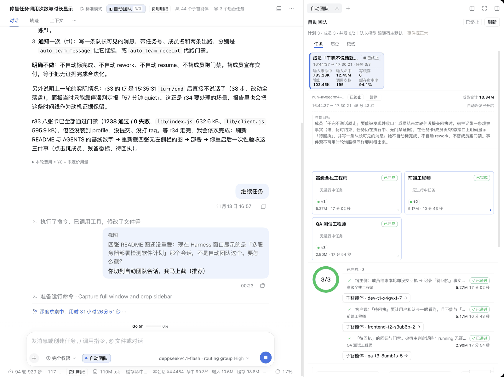
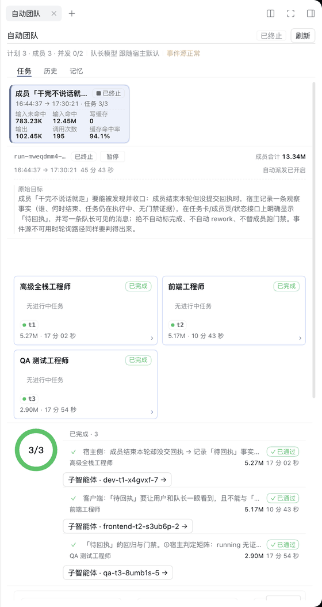
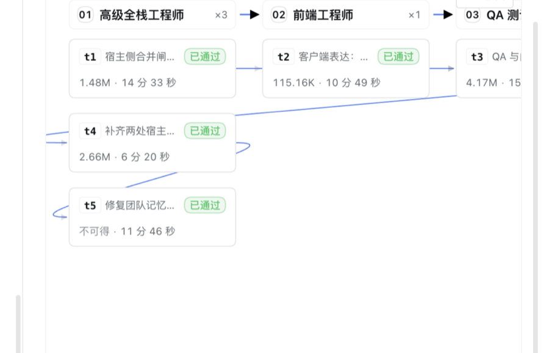
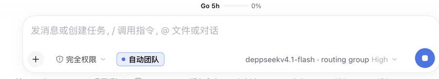

# dsh-auto-team

[简体中文](./README.md) · [English](./README.en.md)

Turn the current DeepSeek Harness session into a team lead: the goal becomes a **dependency-aware task graph**, roles **dispatch in parallel** to resumable sub-agents, every completion must pass a **quality gate**, and the whole run stays visible and editable from the composer switch and the right-side panel.

Current version `dsh-auto-team@0.2.6` (`package.json`), compatible with Node `>=22.18` and DSH `>=0.2.1-alpha.2 <0.3.0`, verified on host `0.2.2-rc.2`.

## Features

1. **Multiple tasks + dependency graph**: one goal becomes a task graph with `dependsOn`; `maxConcurrent` (default 3, configurable 1..8, clamped by the host limit) caps how many run at once; a downstream task only leaves `blocked` after its upstream passed the gate and became `done`; a flow node jumps straight into the member session that runs it (`onJump` in `src/client/views/FlowCanvas.tsx` → `uiWorkspace.openSession`, and when there is no member or the session is unreachable the reason is stated, never swallowed).
2. **Automatic team assembly**: the lead reads the goal and picks a `roleId` per task from 11 built-in roles (product / architecture / full-stack / frontend / backend / design / QA / docs / review / DevOps / security audit); a missing role is never guessed — dispatch is skipped with `ROLE_UNAVAILABLE`; write scopes (`writeScopes`) are mutually exclusive, so a conflicting task moves to `waiting` with "who it waits for and on which path" spelled out and **holds no concurrency slot**; role cards show role / task / duration.
3. **Per-sub-agent models**: a role can bind `model{provider,model,reasoningEffort}`; when undeclared it follows the session default; an unresolvable model blocks dispatch (`MODEL_UNRESOLVABLE`) instead of silently falling back to the lead model; before reusing an idle member the host compares the role's target route with **that member's real session route**, and creates a new member (plus a message) when they differ (the reuse gate in `src/host/team/dispatch.ts`).
4. **Gate = evidence**: the only path from `running` to `done` is `auto_team_receipt` — it really runs the acceptance command and records the exit code plus the **last 4000 characters** of output (the full log lands in `<workspace>/.auto-team/artifacts/<taskId>.log`); a failure turns into `rework` with the evidence sent back to the same member and downstream tasks stay `blocked`.
5. **Observable panel**: run / task / member all carry duration and tokens (cache hits, output, call count, hit rate = `cacheRead / (input + cacheRead)`); when the source reports nothing the cell reads "not available" — no zeros, no estimates; stalls have three states `none` / `quiet` / `unreported`, only `quiet` (progress signals exist but stopped) is flagged, `unreported` says "insufficient evidence"; a member that ends its turn without a receipt is recorded as `silentFinish`, the task row shows "awaiting receipt", and the lead is notified exactly once.
6. **Team memory + member self-service**: memory is two tracks of md (public + project); entries carry P0/P1/P2, `supersede` replaces older entries, and injection respects a character budget (default 4000 — what does not fit stays out of the context and remains reachable by its `mem://` id); a member can read its own task and submit its own receipt from its own sub-session, while passing someone else's `taskId` returns `FORBIDDEN`.

## 30-second tour

All commands run at the repo root; copy this line first (it lands on the repo root from any subdirectory):

```bash
export REPO="$(git rev-parse --show-toplevel)" && cd "$REPO"
```

1. **Install** (this machine uses profile `desktop`; `dsh` is not on PATH):

```bash
cd "$REPO" && pnpm install
cd "$REPO" && pnpm build
cd ~/.dsh/profiles/desktop
pnpm add "file:$REPO"
grep -n '"dsh-auto-team"' package.json
```

If `grep` shows only 1 line (no `dsh.profile.bundles` entry), add `"dsh-auto-team"` to that array by hand, then restart.

2. **Turn it on**: restart the host and refresh the GUI. The "auto team" capsule on the **left** of the composer is the per-session master switch, off by default; it is live only when all four are present — capsule, session-header button, right-side tab, settings section. Miss one and the install is incomplete.

3. **Dispatch the first task and accept it**: tell the lead the goal (e.g. "split this requirement into tasks and dispatch the team"). The lead calls `auto_team_plan`, every task needs a `roleId` and an **executable** `acceptance` (a blank one rejects the whole batch), and a saved plan **auto-dispatches**; after a member reports back, the lead session with the switch on (or that member) submits a receipt, `auto_team_receipt` actually runs the gate, and only `exit 0` becomes done.

Rollback is three commands (the last line should print `0`):

```bash
cd ~/.dsh/profiles/desktop
pnpm remove dsh-auto-team
grep -c '"dsh-auto-team"' package.json
```

## How one requirement runs

| Step | What happens | What you can see / change |
| --- | --- | --- |
| Split | The lead calls `auto_team_plan` to build tasks with `dependsOn`, each with a `roleId` + `acceptance`; blank acceptances, missing dependencies or cycles reject the whole batch | The panel "plan" page lets you change roles and cancel tasks; cancelling drops the member count to 0 |
| Dispatch | Ready tasks are taken in dependency order, at most `maxConcurrent`; write-scope conflicts queue as `waiting`; `auto_team_dispatch` only confirms idempotently (no `runId` is rejected outright) | Task status: `pending` / `waiting` / `running` / `gate` / `rework` / `done`, plus `paused` (frozen), `interrupted` (member died, resumable), `failed`, `cancelled` and `skipped` |
| Work | Members are resumable sub-agents reached directly with `auto_team_message`; idle members may be reused, and a different route creates a new member | Click a member card or a flow node to open that member's session |
| Receipt | A member or the lead calls `auto_team_receipt`, which really runs acceptance and records the exit code and output tail; a failure turns into `rework`, the evidence goes back to the same member, downstream stays `blocked`, and the per-task rework cap defaults to 3 (configurable 1..10) | Gate conclusion and command on the task row, full log in artifacts, "rework" badge with evidence, no auto-retry past the cap |
| Requirement changed | Pass `revise: true` to stay in the same run (without it a new run is created); `auto_team_add_tasks` appends, and cancelled tasks keep their downstream `blocked` | The "requirement updated" capsule at the top of the panel |

## Capabilities

| Capability | Entry point | Notes |
| --- | --- | --- |
| Enable / disable (per session, default off) | Capsule on the left of the composer | `conversation.input.left`; when off every tool answers "not enabled" |
| Right-side panel (tasks / history / memory) | "Auto team" tab in the right sidebar | keyed slot: `sidebar.right.pane.tab` + `.title`, and it must also register into `sidebarRightTabs` |
| Project library / memory | Left sidebar section + full-page main area; panel "Memory" (project track), "Global" (public track) | Falls back to an inline library if the main-area registration fails; two-track md, also via `auto_team_memory` |
| Settings / roles / skills | "Auto team" settings section | 6 parameters; 11 built-in roles + 12 skills, editable but not deletable (skills can be restored) |
| Lead tools (8) | Callable in any session with the switch on | `plan` → `dispatch` form the backbone; `add_tasks` / `status` / `message` / `receipt` (the only completion path) / `memory` / `role` complete the set; when disabled all of them return the same "auto team is not enabled…" message |

## Screenshots

Four screenshots from a real host (macOS desktop, 1728×1084; the tasks page and dependency graph come from a 5-task / 5-member run on 2026-11-10):


Panel overview: the conversation area plus the right-side "auto team" panel, left navigation cropped.


Tasks page: run header (`plan 5 · members 5 · concurrency 0/3`), usage block, member cards grouped by role (role / task / duration), completion ring and per-task gate conclusions.


Dependency graph: every node carries its tokens and duration (unavailable reads "not available", never 0), and clicking a node opens the member session that runs it.


Entry point: the capsule at the bottom-left of the composer, enabled per session; while off no member is ever created.

Source files of all four images: [panel overview](docs/images/panel-overview.png), [tasks page](docs/images/panel-tasks.png), [dependency graph](docs/images/panel-flow.png), [composer switch](docs/images/entry.png).

## Compatibility and version support

| Component | Required / verified | Evidence |
| --- | --- | --- |
| Node.js | `>=22.18` (declared); measured `v26.11.1` here | `package.json` `engines.node`; `node -v` |
| DSH host | `>=0.2.1-alpha.2 <0.3.0` (declared); verified on `0.2.2-rc.2` (macOS desktop) | `package.json` `engines.dsh`; `CFBundleShortVersionString` |
| Member API boundary | **since 0.2.2-rc.2** member capabilities live in `subagents`; the old `agentTeams` only keeps task-book methods | `HostSubagents` in `src/host/adapters.ts` |

**Honest boundary**: only `0.2.2-rc.2` is installed here, so the old `0.2.1-alpha.2 ~ 0.2.2-rc.1` path has unit-test stubs but no real-host regression; `engines.dsh` is a declared range, not a per-version verification.

```bash
node -v
node -e "const p=require('./package.json');console.log(p.version,p.engines.node,p.engines.dsh)"
```

License: MIT (see [LICENSE](LICENSE))

## Where data lands

| Path | Contents |
| --- | --- |
| `~/.dsh/auto-team/runs/` | Run state: plan, tasks, member bindings, gate evidence, `termination` |
| `~/.dsh/auto-team/sessions.json`, `settings.json` | Per-session switch; 6 parameters (concurrency, memory budget, stall threshold, rework cap, gate timeout, lead model) |
| `~/.dsh/auto-team/roles/<id>.json`, `skills/<id>.md` | Roles and skills (seeded on first start; editable, not deletable) |
| `~/.dsh/auto-team/memory/public/`, `<workspace>/.auto-team/memory/` | Public (cross-project) and project memory; the project `workspace` is resolved from the real run project and reports `degraded/degradeReason` when it cannot be resolved |
| `<session workspace>/.auto-team/artifacts/<taskId>.log` | Full gate log (relative paths inside acceptance commands are usable) |

Inspect what landed, and clean up historical data (backfill is idempotent; curation starts as a dry run):

```bash
ls ~/.dsh/auto-team/
ls ~/.dsh/auto-team/runs/ | tail -5
ls .auto-team/memory/
node src/host/memory/backfill-cli.ts --dry-run
node src/host/memory/curate-cli.ts --track project --dir "$(pwd)/.auto-team/memory" --dry-run
```

## Troubleshooting

The three most common cases only; the rest are in [ARCHITECTURE.md](docs/teamflow/architecture/ARCHITECTURE.md) §9 and [memory.md](docs/teamflow/memory.md).

| Symptom | Real cause | Fix |
| --- | --- | --- |
| Every tool answers "not enabled" | Tools identify the session via `exec.agent.id`, the panel records the switch on the real session | Flip the switch in the **same session**; never fall back to `'current'` |
| Build is green but the right-side tab never appears | A keyed slot without `key`, or the tab was not registered into `sidebarRightTabs` | Both keys and `register({id})` must match; rerun `pnpm test` after the fix |
| Every panel request is `HTTP 404` | `webServer` is not active yet at `apply` time | This repo registers in two stages (try once + `ctx.inject(['webServer'])`); in DevTools `GET /api/auto-team/snapshot?sessionId=…` should be 200 and include `roles` |

```bash
grep -rn 'sidebarRightTabs' src/client/slots.ts
grep -rn 'ctx.get' src/host/adapters.ts | wc -l
node --test test/r29-packaging.test.ts
```

## Known limitations

- **A member session can only see / submit its own task**, and member self-service is also gated by the switch: when the lead session that owns the run is off, `status` and `receipt` both answer "not enabled".
- **Configured concurrency may be clamped by the host**: setting 6 may still run 3; the setting is a request, and the snapshot carries requested / clamped markers.
- **The left sidebar section and full-page project library are not verified on a real host (U2)**: a failed registration falls back to the inline panel library, so the right panel is unaffected; the four screenshots only cover the right panel and the composer entry.
- **Pause only stops dispatch, receipts, and stall detection**: running members keep writing files; interrupt that member in the panel to stop it immediately; a saved plan auto-dispatches with no "review first" switch, so pause before confirming if you want to review.
- **Usage on old runs may stay "not available" forever**: those runs ended on older builds and their sessions are gone; the memory page token count carries `≈` because it is estimated from characters (about "chars / 2"), not provider-reported.

## Development and verification (must be green before committing)

```bash
cd "$REPO" && pnpm typecheck
cd "$REPO" && pnpm test
cd "$REPO" && pnpm build
node --input-type=module -e "await import('./lib/index.js')"
node --input-type=module -e "await import('./lib/client.js')"
npm pack --dry-run --cache /tmp/npm-pack-cache
```

Reproduce the whole chain in one line:

```bash
export REPO="$(git rev-parse --show-toplevel)" && cd "$REPO" && pnpm typecheck && pnpm test && pnpm build && node --input-type=module -e "await import('./lib/index.js')" && node --input-type=module -e "await import('./lib/client.js')" && npm pack --dry-run --cache /tmp/npm-pack-cache
```

- Baseline (measured 2026-11-17): `pnpm test` **1297 pass / 0 fail / 0 skipped**; `npm pack --dry-run` lists 9 files (`package.json`, `LICENSE`, both READMEs, `cordis.patch.yml`, both `lib/` bundles, `locale/en.json`, `locale/zh.json`), with `LICENSE` included automatically by npm.
- Do not bypass: `lib/` must be committed (it is the `pnpm add file:` install source); local imports carry the `.ts` extension; host and client never import each other and only talk over `GET/POST /api/auto-team`; host service access is concentrated in `src/host/adapters.ts`.

## Documentation

| What you need | Where |
| --- | --- |
| Architecture, module contracts, data flow, build / test / CI, unfinished list | [ARCHITECTURE.md](docs/teamflow/architecture/ARCHITECTURE.md) |
| Host events, UI slots, real-host verification | [HOST-EVENTS.md](docs/teamflow/architecture/HOST-EVENTS.md), [UI-SLOTS.md](docs/teamflow/architecture/UI-SLOTS.md), [REAL-HOST-VERIFY.md](docs/teamflow/architecture/REAL-HOST-VERIFY.md) |
| Revising one requirement: merge, cancel, stopping states | [r21 merge & replan](docs/teamflow/2026-11-10-r21-merge-replan/QA-REPORT.md) |
| Team conventions and pitfalls | [memory.md](docs/teamflow/memory.md) |
| Per-requirement task folders (newest first = iteration history) | [docs/teamflow/](docs/teamflow/) |
| Collaboration rules and doc index | [AGENTS.md](AGENTS.md) |
