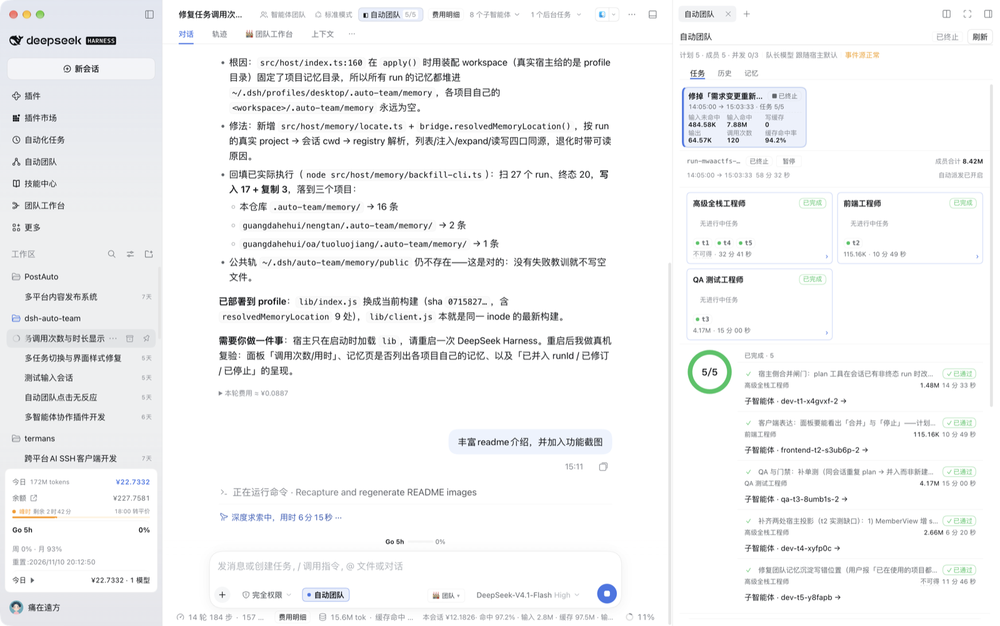
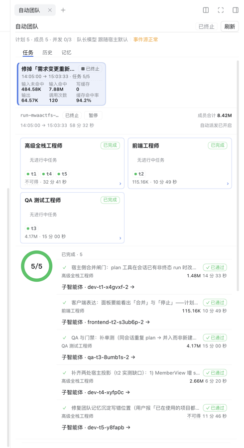
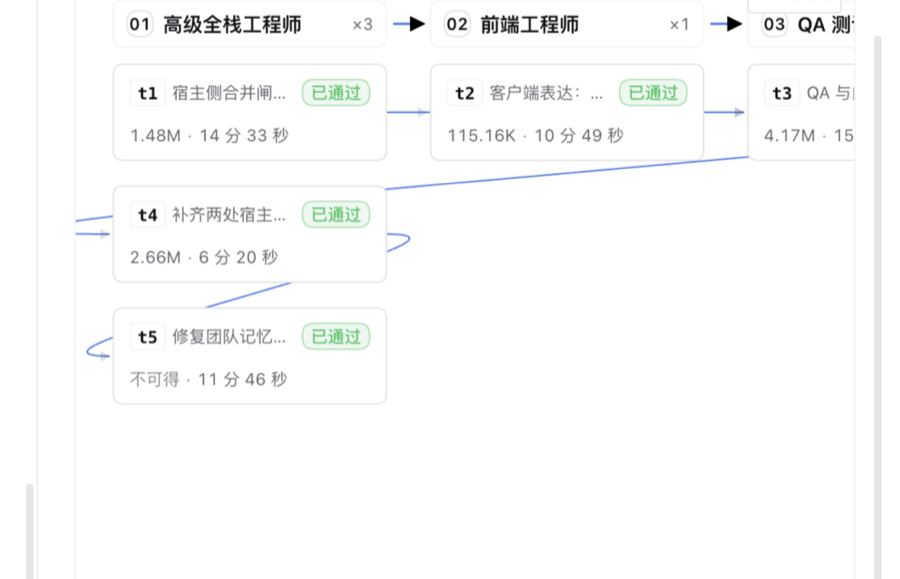

# dsh-auto-team (Auto Team)

English · [简体中文](./README.md)

Turns the current DeepSeek Harness session into a **lead**: it splits a goal into a **dependency-aware task graph**, dispatches resumable members by role **in parallel**, and makes every completion pass a **quality gate** — all of it visible and editable from the toggle left of the input box and the right-side "自动团队" (Auto Team) panel. When a requirement changes, it is **merged back into the same run** instead of opening a second plan that fights the first one.



- Package / version: `dsh-auto-team@0.2.1` (`package.json`)
- Runtime constraints: Node `>=22.18`; DSH `>=0.2.1-alpha.2 <0.3.0` (`engines` in `package.json`)
- Every command in this file is run inside the repository. Copy this line first (it works from any subdirectory; afterwards `$REPO` is the repo root):

```bash
export REPO="$(git rev-parse --show-toplevel)" && cd "$REPO"
```

## Compatibility and version support

| Component | Required / verified | Evidence |
| --- | --- | --- |
| Node.js | `>=22.18` (declared); verified on this machine at `v26.11.1` | `engines.node` in `package.json`; `node -v` |
| DSH host | `>=0.2.1-alpha.2 <0.3.0` (declared) | `engines.dsh` in `package.json` |
| Verified on real host | DSH `0.2.2-rc.2` (macOS desktop) | `CFBundleShortVersionString` + the version string inside `app.asar` |
| Team API boundary | **From 0.2.2-rc.2** member capabilities live in the `subagents` service; the old `agentTeams` keeps only task-board methods | `src/host/adapters.ts:59-101` (`HostSubagents`), `:62-65` (verbatim host comment) |
| Dual-path compatibility | Per-capability `typeof` probing: the new API wins, the old one is a fallback | `src/host/adapters.ts:1304-1310`, `:1392-1413`, `:1428-1450`, `:1543-1556`, `:1862-1871` |

### Host API boundary: 0.2.2-rc.2 moved the Team API to `subagents`

Verbatim host comment: *teammates are subagents, so subagent limits and inbox delivery apply*. Consequently the member methods on `agentTeams` (`spawnTeammate / sendMessage / listMembers / tryMembership / interrupt`) **have been removed**; only task-board methods remain (`isEnabled / setEnabled / createTask / getTask / listTasks / updateTask`), and member capabilities moved to `subagents` wholesale.

| Capability | From 0.2.2-rc.2 (new host) | Old-host fallback | Code in this repo |
| --- | --- | --- | --- |
| Create member | `subagents.startActivation({ provider, label, name, prompt, parent, signal, delivery: 'parent', agentOptions })` | `agentTeams.spawnTeammate(caller, request)` | `src/host/adapters.ts:1333-1359` / legacy branch `:1364` |
| Direct message | `subagents.sendMessage(caller, targetSessionId, content, { signal })` (by **SessionId**, no name table) | `agentTeams.sendMessage(caller, { target: memberName, content, signal })` | `src/host/adapters.ts:1392-1413` |
| Interrupt member | `subagents.resolveName(caller, name)` → `subagents.interrupt(sessionId, authority)` | `agentTeams.interrupt(caller, name)` | `src/host/adapters.ts:1428-1450` |
| Member roster | `subagents.listDescendants(rootOf(caller).id)` | `agentTeams.listMembers(caller)` | `src/host/adapters.ts:1543-1556` |
| Member identity | `subagents.namesOf(agent)` (slash path from root; root is `lead`) | `agentTeams.tryMembership(agent)` | `src/host/adapters.ts:1862` / `:1871` |

Two naming traps already hit on a real host:

- **`provider` in the member-creation request is a subagent provider name, not an LLM provider name**: the host resolves it with `subagents.getProvider(name)`, and this machine registers only `spawn`. Passing an LLM provider such as `opencode-go` yields `no subagent provider registered for "<name>"` and **every dispatch fails** (r12 real-host incident). This repo falls back in this order: `getProvider('spawn')` → the `list()` registry (prefer `spawn`) → the constant `spawn` (`src/host/adapters.ts:1010`, `:1269-1287`).
- **Per-role models do not travel in `provider`**: they go in `agentOptions: { provider, model, reasoningEffort, maxTokens }`, carried down by `startActivation` (`src/host/adapters.ts:1119-1131`).

Honest boundary: only 0.2.2-rc.2 is installed on this machine, so the legacy `agentTeams` path for `0.2.1-alpha.2 ~ 0.2.2-rc.1` **cannot be regressed in this environment**; it is currently covered only by unit-test stubs (the new/old-host cases in `test/adapters.test.ts`) and has no real-host evidence. `engines.dsh` declares a supported range; it does not mean every version was tested. After upgrading to 0.2.2-rc.2, confirm the "install is effective" checks one by one.

## What it solves

- **One person cannot finish a requirement alone**: the lead splits the goal into a task graph and dispatches by role (product / design / architecture / full-stack / QA plus custom roles) to sub-agents; tasks whose dependencies are unfinished never jump the queue.
- **Parallel without collisions**: write scopes (`writeScopes`) are mutually exclusive, so only one task changes a given slice of files at a time; the concurrency limit defaults to 3, can be set to 1..8, and is clamped by the host limit.
- **"Done" does not count**: every task carries an executable acceptance command, and only `exit 0` flips it to done; failures go back for rework, the evidence is sent to the original member, and downstream tasks stay blocked.
- **Changed requirements do not restart the run**: revise tasks, add tasks, and cancel tasks inside the same run; work already done is preserved, and the panel shows "revised / cancelled / stopped".
- **Money and time are accounted for**: token and duration numbers per task, per role, and per run are real; when a number is unavailable it reads "not available" — **no zeros, no estimates**.

## Screenshots

The screenshots below come from a real machine (macOS DSH desktop app, 1728×1084 window, one 5-task / 5-member run on 2026-11-10).

### Tasks page: progress, roles, and the dependency graph in one view



The run header reads `计划 5 · 成员 5 · 并发 0/3 · 队长模型 跟随宿主默认 · 事件源正常 · 已终止` (plan 5 · members 5 · concurrency 0/3 · lead model follows host default · event source healthy · terminated). Below it are this run's usage block (`调用次数 120`, cache hit rate 94.2%), member cards grouped by role (each with real call counts and accumulated duration), the completion ring (5/5), and the acceptance verdict for every task. The "requirement updated" capsule at the top means this run was revised.

### Dependency graph: who waits for whom, and what each task cost



Solid edge = completed, dashed = unfinished; task cards carry tokens and duration directly (e.g. `1.48M · 14 分 33 秒`). The tokens for `t5` read `不可得` (not available) — that run had no readable usage source, and the panel leaves it blank instead of printing 0.

### Toggle and entry points


The "自动团队" capsule at the bottom-left of the input box is the **per-session** master switch (while off, every tool answers "not enabled" and no member is ever started silently; **member self-service is gated by the switch too**: the member's own status query and receipt submission both require the run's lead session to have the switch on); "自动团队" in the left sidebar is the cross-run project library entry point.

## 30-second tour

1. Click the "自动团队" capsule on the **left** of the input box. It is off by default; the switch is recorded per session in `~/.dsh/auto-team/sessions.json`, and toggling it alone never starts a member.
2. State the goal to the lead directly. The lead first calls `auto_team_plan` to lay down a task graph; every task must carry a `roleId` and an **executable** `acceptance` (an empty acceptance rejects the whole batch and nothing is persisted).
3. Once the plan is persisted it is **dispatched automatically** — no "dispatch" button needed: concurrency limit, dependency gating, write-scope conflicts, and pause are all decided in one place (`dispatchReady` in `src/host/team/dispatch.ts`); tasks beyond the concurrency limit queue up.
4. After a member delivers and reports back, the receipt is submitted by **the lead session with the switch on or by that task's own member** → `auto_team_receipt` runs that task's `acceptance`, and **only `exit 0` means done**; a failure turns the task to rework, keeps downstream blocked, and sends the failure evidence back to the original member. A member sub-session can call `auto_team_status` to inspect only its own task (a field whitelist: no members, memory, roles, or other tasks) and call `auto_team_receipt` for **its own task** (another task's `taskId` returns `FORBIDDEN`; every other tool still answers "not enabled"). **Member self-service is gated by the switch too**: when the run's lead session has the switch off, both tools answer "not enabled" with the same wording for the member as well (never one allowed and the other rejected).
5. When the requirement changes: tell the lead what to change, and the lead passes `revise: true` to **merge the change back into the same run** (see "Revising the same requirement"); unrelated new requirements still open a new run.

## Capabilities and entry points

| Capability | Entry point | Where it lives |
| --- | --- | --- |
| Enable / disable (per session, off by default) | The `conversation.input.left` capsule left of the input box | Mount points: `src/client/slots.ts:41` |
| Open the right-side panel | The `conversation.session.header.actions` header button | `src/client/slots.ts:44` |
| Three panel pages: tasks / history / memory | The right-side "自动团队" tab (keyed: `sidebar.right.pane.tab` + `.title`) | `src/client/Panel.tsx:81` (`TABS` is the single source; the `TabKey` type is at :78) |
| Project library (cross-run list, history detail, global memory) | Left-side "自动团队" section `sidebar.panellist` + full-page `main` | `src/client/slots.ts:441,449`; if main-area registration fails it degrades to an inline library inside the panel |
| Settings: parameters, roles, skills | Settings page `settings.section` | 6 parameters + role/skill editing (`src/client/SettingsPage.tsx`) |
| Memory | The panel's "memory" tab lists **project memory** only; public memory is under "global" in the left sidebar | Two-track md; read/write also via `auto_team_memory` |
| Roles | **11** built-in + custom; each role may pin `provider/model` | `src/host/roles/builtin.ts:230` (`BUILTIN_ROLES`) |
| Skills | **12** built-in; sources `builtin/imported/system/manual`; built-ins are editable and restorable to factory | `src/host/roles/builtin.ts:22` (`BUILTIN_SKILLS`) |
| Usage / duration | Six task-card fields such as "call count", run-header duration, per-role accumulated duration | "Not available" when the source is missing — see "Usage and durations" |

> There is **no** "dispatch" button in the panel: dispatch is triggered automatically when a plan is persisted. What a human can do is pause/resume, change roles, cancel/skip a single task, and edit the acceptance command. The role page has been removed from the panel and is maintained only in settings.

## Revising the same requirement (revise)

**Only changes to the same requirement merge back into the old run**; unrelated new requirements open a new run as before. The decision belongs to the lead: without `revise`, `auto_team_plan` **always creates a new run** — there is no "guess and merge".

| Parameter | Effect |
| --- | --- |
| `revise: true` | The only merge switch; the target run comes from `runId`, defaulting to the current session's most recent non-terminal run |
| `runId` | Which run to merge into; pointing at a terminal run returns `BAD_REQUEST` instead of silently creating one |
| `changeSummary` | The change summary, written verbatim into the direct message to running members and into the task cards' revision note |
| `cancelledTaskIds` + `cancelReason` | Tasks obsoleted by the new requirement: flipped to `cancelled`, with the reason shown in the panel |

- In `tasks[]`, **an id that matches an existing task updates** its goal/acceptance, and **a new id is appended**; a batch that both updates and cancels is rejected as a whole.
- `goal` is **appended** as a `## 需求修订（YYYY-MM-DD HH:mm）` section, preserving the original goal and its history.
- Three `mode` values are returned: `created` (new run, plus an `activeRunId` hint saying "pass revise=true to modify"), `revised` (a full receipt of `updated[]/added[]/cancelled[]/skipped[]/notified[]/stopped[]`), and `appended` (pure append).
- Members never vanish silently: cancelled members get "已被新需求作废（原因：…），请立即停止当前实现，不要按旧理解提交回执"; revised members get "目标/验收已更新"; unaffected members are told "整体需求已修订、你的目标与验收未变".
- Stopping is **persist first, interrupt second**: `stopping` (interrupt sent, stop not yet confirmed) → `stopped` + `stoppedAt` only after the interrupt succeeds; a failed interrupt stays `stopping` with a reason and **never falsely reports stopped**.
- When the last batch of tasks is entirely cancelled, the run closes itself as `terminated` with `finishedAt` + `termination.reason`, and its duration is still computable.

## Install (profile `desktop` on this machine; `dsh` is not on PATH)

Prerequisites: `node -v` ≥ 22.18; the profile directory `~/.dsh/profiles/desktop` exists and the current process can write to it (`pnpm add` rewrites the profile's `package.json`, so a restricted sandbox session will be refused).

```bash
cd "$REPO" && pnpm install        # first clone only: tsdown/typescript live in devDependencies (verified with pnpm 10.x)
cd "$REPO" && pnpm build          # produce lib/index.js + lib/client.js first (lib/ is the install source)
cd ~/.dsh/profiles/desktop
pnpm add "file:$REPO"
grep -n '"dsh-auto-team"' package.json   # expect two lines: one dependency, one in dsh.profile.bundles
```

If `grep` prints only 1 line (dependency but no bundle entry), add `"dsh-auto-team"` to the `dsh.profile.bundles` array by hand, then restart.

An install is effective only when all of these hold (any missing = not effective):

1. Restart the DeepSeek Harness host process and reload the Web GUI.
2. The "自动团队" capsule appears left of the input box; the same-named button appears in the session header; the "自动团队" tab appears on the right side; the "自动团队" section appears in settings.
3. Tell the lead "use `auto_team_status` to show the current team state": a snapshot structure (empty fields when there is no plan) means it is active; the answer "自动团队未启用…" only means **the switch is off**, not that the install is broken.

Rollback:

```bash
cd ~/.dsh/profiles/desktop
pnpm remove dsh-auto-team
# then delete "dsh-auto-team" from dsh.profile.bundles in package.json
grep -c '"dsh-auto-team"' package.json    # expect 0
```

## The 8 tools the lead can call

While disabled, all of them return the same Chinese error: `自动团队未启用：请在输入框内的「自动团队」选项处启用后再试。`

| Tool | Purpose | Key constraint |
| --- | --- | --- |
| `auto_team_plan` | Persist an execution plan and return a `runId` | Empty `acceptance` / illegal write scope rejects the whole batch and persists nothing; with `revise: true` it merges into an existing run instead (see the previous section) |
| `auto_team_add_tasks` | Append tasks to **the same** run | `runId` is mandatory; content fingerprint is idempotent; atomic batch; terminal runs are refused |
| `auto_team_dispatch` | Manually dispatch ready tasks | **Must carry the `runId` returned by plan**; missing it is rejected outright (the mechanical guarantee that the plan precedes the members) |
| `auto_team_status` | Read plan, members, gate evidence, message ledger | Read-only; with no plan it returns empty fields instead of an error; a member session only sees its own task (whitelisted fields), and only while the run's lead session has the switch on |
| `auto_team_message` | Reach a member directly (by taskId or member name) | Resumable; after an interruption continue with the same `memberId` instead of creating a same-named member |
| `auto_team_receipt` | Submit a receipt and run the gate | The **only** entry from `running → done`; a member saying "finished" does not count. **The lead session with the switch on, or that task's own member, may submit it** (member self-service is gated by the switch too: when the run's lead session has it off, receipt answers "not enabled" exactly like status); a member passing another task's `taskId` gets `FORBIDDEN`, and the gate is still executed by the host (`memberIdentityOf` and the receipt branch in `src/host/tools.ts`) |
| `auto_team_memory` | Read/write the two-track memory (`list/read/write/expand/curate`) | `write` supports `importance` (P0/P1/P2), `topic`, `supersedes`; dedupes on normalized text and counts "revision count"; `read/list` return a structured entry view (id/level/text/source/revisions/superseded); `expand` fetches the full text by `mem://` id; `curate` tidies old logs (`dryRun` defaults to true); the response carries `projectDir/workspace/degraded/degradeReason` |
| `auto_team_role` | Role read/write (`list/save/remove`) | Built-in roles can be edited but not deleted |

## Gate (acceptance) semantics

- Execution directory = **the session workspace** (`agent.session.header.cwd`): resolved per session at gate time (assembly layer `sessionWorkspace()` in `src/host/index.ts` → `sessionWorkspaceOf()` in `src/host/adapters.ts`); tool receipts and panel actions each resolve against their own session.
  - When it cannot be resolved (old host without `agents.get`, no agent for the session yet, or a resolution error), it falls back to the assembly `workspace` (`options?.workspace ?? process.cwd()`), matching the behavior before the fix; the fallback is not treated as an error.
  - Gate logs land in `<session workspace>/.auto-team/artifacts/<taskId>.log`, so repo-relative paths in acceptance commands (e.g. `test -s README.md`) work directly.
- Default timeout `300000ms` (`GATE_TIMEOUT_MS`); evidence keeps the **last 4000 characters** of output (`GATE_TAIL_CHARS`).
- Verdict: `exit 0` = pass; a non-zero code, a timeout, or a signal kill (`exitCode: null`) all count as a failure.
- Failure → the task flips to `rework` and the command/exit code/output tail go back to the same member; downstream stays `blocked` and never runs on a broken upstream.
- Write scopes: only `running` / `gate` hold a scope and release it on exit; a conflict means equality or a **directory-boundary prefix** (`src/host` does not conflict with `src/hostile.ts`). Waiters get a release notice and the task card shows "waiting for write scope".
- 5 irreversible actions need a second confirmation (`cancel` / `cancelTask` / `skipTask` / `updateAcceptance` / `forceParallel`); everything else is reversible and never prompts; a confirmed action reuses the same execution body, so behavior does not drift.

## Usage and durations

Numbers in the panel come from exactly three sources, and **when a source is missing the panel says "not available" with a reason** — nowhere does it fill in 0 or estimate:

| Metric | Source | When it is unavailable |
| --- | --- | --- |
| tokens (input/output/cache read-write/hit rate) | The tokenUsage projection in host `sessionProjections`, persisted per member | The projection is unreadable (old run not persisted, session destroyed) |
| call count | Number of `assistant/message` events in the member session's event stream (one = one model call) | The session events are unreadable; a readable 0 is a real 0 |
| duration | Run: `plannedAt → finishedAt` (now while running); task: start/end in `taskTimes[id]`; role: **accumulated** duration of its tasks | Missing start/end instants (started but no `startedAt`, or time running backwards) |

- When a terminal run's historical data lacks `finishedAt` (persisted by an older version), it is **derived** from `max(taskTimes[].endedAt)` and the last message timestamp, whichever is later — read-only, never written back, so historical durations stay computable.
- A started task with missing instants is described in plain words, e.g. "not available: task t3 is missing its start/end instants"; a task that never started contributes 0, which is not counted as missing.

## Memory (two-track md + entry level)

Team memory is markdown in two tracks: the public track `~/.dsh/auto-team/memory/public/` (cross-project) and the project track `<workspace>/.auto-team/memory/`. One file per topic, one entry per line:

```
# 失败与教训

- [P1] 门禁 `pnpm test` 失败（退出码 1）（来源：系统 · 11-10 17:20 · 修正 1）
```

- **Topic files**: `conventions` (convention fallback), `pitfalls` (failures and lessons), `decisions` (decisions, project track only), `commands` (verified commands), `domain` (business domain, project track only), `architecture`. The public track additionally has `workflow` and `host`; the project track additionally has `ui`. Topics are routed automatically from body keywords; an explicit `topic` is validated against the current track, and crossing tracks returns `BAD_TOPIC` (no silent downgrade).
- **Levels**: `P0` iron rules / manually pinned (auto-consolidation **never** produces P0 and eviction never picks P0); `P1` failure lessons and legacy hand-written lines; `P2` default and verified commands. Writing the same entry again takes the higher level and increments `revisions`.
- **Limits**: 8 project / 6 public files (adding a topic file beyond the limit errors first and asks you to tidy up); 40 active entries per file, evicted oldest-P2-first then oldest-P1; all-P0 refuses the write with a readable reason. Tombstones (the `## 已作废` section) do not count toward the 40 but are capped at 20 per file.
- **Auto-consolidation**: after a run reaches `terminated` / `cancelled`, only `pitfalls/P1` (failure evidence; nothing without failures) and `commands/P2` (gate evidence with `exit 0` and a command, deduped by body hash) are written; when there were failures the public track gets one extra `pitfalls/P1` reminder. `run-<runId>.md` / `lessons-*.md` are **no longer generated**; old log files remain readable but are not parsed, not counted against the quota, and **never injected**.
- **Injection**: entries are selected individually (P0 first, then by relevance to the goal), excluding tombstones and old `run-*.md` files, within `MEMORY_INJECT_BUDGET` (default 4000 characters, adjustable in settings); entries that do not fit are listed in a trailing "N more not inlined" line, and `auto_team_memory expand` fetches the full text by `mem://` id.
- **Tidying old logs**: extract failure evidence from old `run-*.md` files into `pitfalls.md` (add-only, idempotent):

```bash
cd "$REPO" && node src/host/memory/curate-cli.ts --track project --dir "<项目记忆目录>" --dry-run   # preview first
cd "$REPO" && node src/host/memory/curate-cli.ts --track project --dir "<项目记忆目录>"             # then apply
```

The panel's "memory" tab also has a "tidy old logs" button that previews with dry-run first and then applies; the `curate` action of `auto_team_memory` supports the same, with `dryRun` defaulting to true.

## Where data lands

| Path | Contents |
| --- | --- |
| `~/.dsh/auto-team/runs/` | Run state (plans, tasks, member bindings, gate evidence, `termination`) |
| `~/.dsh/auto-team/sessions.json` | Per-session switches |
| `~/.dsh/auto-team/settings.json` | The 6 configurable parameters (concurrency 1..8 default 3, memory budget 200..4000, stall 1s..600s default 90s, rework limit 1..10, gate timeout 1s..600s default 300s, lead model) |
| `~/.dsh/auto-team/roles/<id>.json` | Role definitions (one file per role; built-ins are seeded on first start and can be edited but not deleted) |
| `~/.dsh/auto-team/skills/<id>.md` | Skill bodies (built-in overlay + imported/system/hand-written, with frontmatter) |
| `~/.dsh/auto-team/memory/public/` | Public memory (cross-project) |
| `<workspace>/.auto-team/memory/` | Project memory. `workspace` is resolved from the **run's real project** (`run.project` → session cwd → workspace registry) instead of the assembly workspace; when nothing resolves, it degrades explicitly to the assembly directory and reports `degraded/degradeReason` in the snapshot and in the `auto_team_memory` response |
| `<session workspace>/.auto-team/artifacts/<taskId>.log` | Full gate logs (follow the session workspace; fall back to the assembly workspace when unresolvable) |
| `~/.dsh/auto-team/deviations.jsonl` | Audit trail of times the lead edited files itself (append-only) |

Legacy project memory can be moved back to its own project with a backfill command (idempotent; existing entries are not overwritten):

```bash
cd "$REPO" && node src/host/memory/backfill-cli.ts --dry-run   # see what would move
cd "$REPO" && node src/host/memory/backfill-cli.ts             # actually apply (mode=apply)
```

Path derivation is centralized in `src/host/paths.ts` and `src/host/memory/locate.ts`: `globalDataRoot` already contains `.dsh`, so never append another `.dsh` (that lands in `~/.dsh/.dsh/…`, whose symptom is "saves succeed, everything is gone after restart"). The only exception is the session switch file `sessions.json`, built as `${deps.dataRoot}/sessions.json` at `src/host/bridge.ts:468`.

## Development and verification (must be green before committing)

```bash
cd "$REPO"
pnpm typecheck      # tsc --noEmit
pnpm test           # node --test test/*.test.ts
pnpm build          # both artifacts: lib/index.js (ESM) + lib/client.js (CJS wrapped in __ModuleLoader__)
node --input-type=module -e "await import('./lib/index.js')"
node --input-type=module -e "await import('./lib/client.js')"
npm pack --dry-run --cache /tmp/npm-pack-cache   # must contain lib/index.js, lib/client.js, cordis.patch.yml, both READMEs and locale/*.json
```

### Measured baseline (2026-11-13 06:25, workspace HEAD `608cb24` + uncommitted changes)

```bash
export REPO="$(git rev-parse --show-toplevel)" && cd "$REPO" \
  && pnpm typecheck && pnpm test && pnpm build \
  && node --input-type=module -e "await import('./lib/index.js')" \
  && node --input-type=module -e "await import('./lib/client.js')" \
  && npm pack --dry-run --cache /tmp/npm-pack-cache
```

- `pnpm typecheck` → exit 0
- `pnpm test` → **1179 passed / 0 failed / 0 skipped**, exit 0 (about 7.4s; includes the 6 packaging/documentation regression cases in `test/r29-packaging.test.ts`)
- `pnpm build` → exit 0, `lib/index.js` **613.65 kB**, `lib/client.js` **587.57 kB**
- both `import` self-checks → exit 0
- `npm pack --dry-run` → **8 files / 384.5 kB** (`package.json`, both READMEs, `cordis.patch.yml`, both `lib/` artifacts, `locale/en.json`, `locale/zh.json`)

The numbers drift with the implementation: rerun the group above for current values instead of comparing them against CI output; package size also changes with the size of this README (37.9 kB at that pack).

Do not bypass these: `lib/` must be committed (it is the `pnpm add file:` install source); local imports must carry the `.ts` extension; host and client never import each other directly and communicate only through `GET/POST /api/auto-team`; **host service reads are centralized in `src/host/adapters.ts`**, and the assembly entry `src/host/index.ts` may only call `ctx.logger` (lines 316 / 654 / 658).

## Troubleshooting

| Symptom | Real cause | What to do |
| --- | --- | --- |
| Build is green, the right-side tab never appears | The keyed slot is missing `key`, or the tab was not registered into `sidebarRightTabs` | Both keys and `sidebarRightTabs.register({id,kind})` must use the same value; run `pnpm test` afterwards (it covers the slot convention) |
| Every tool answers "not enabled" | Tools identify the session by `exec.agent.id` while the panel records the switch on the real session | Make sure you toggled it in **the same session**; do not fall back to `'current'` |
| Every panel API returns `HTTP 404` | `webServer` is not active yet at `apply` time | This repo registers in two stages: try once, then `ctx.inject(['webServer'], cb)`; verify in the browser Network tab that `GET /api/auto-team/snapshot?sessionId=…` returns 200 and the body has `roles` |
| The tab appears but content is blank and clicks do nothing | The client used the whole `{data,error}` envelope as data | Read APIs must destructure `{data,error}` (the most frequent past bug family) |
| Nothing changes in the GUI after installing | The host was not restarted, or `cordis.patch.yml`'s `name` was written as a subpath | `name` must be the package root name `dsh-auto-team`, otherwise the clientModules scan skips the plugin |
| Some numbers say "not available" | The data source genuinely has none (old run not persisted, session destroyed, missing start/end instants) | This is the deliberate honest state; check the source in the "Usage and durations" table instead of filling in 0 |
| `npm pack` fails with `EPERM …/_cacache/tmp/…` | The environment cannot write npm's default cache `~/.npm`; **not an ownership problem**: `find ~/.npm -user root` = 0, the owner is the logged-in user (not root), and `touch ~/.npm/_cacache` from this session also fails with `Operation not permitted` (the sandbox denies writes outside the workspace) | Add `--cache /tmp/npm-pack-cache` (or a writable `HOME=/tmp/...`). Do **not** run `sudo chown -R <uid>:<gid> ~/.npm`: uid:gid breaks on another machine, changing the home directory owner is destructive, and it does not lift the sandbox write restriction |

## Known limitations / unfinished

Each item is written as symptom → cause → workaround.

- **A member session can only see/submit its own task (and member self-service is gated by the switch too)**
  - Symptom: in a member session `auto_team_status` returns only that member's task, `auto_team_receipt` accepts only its own `taskId`, and every other tool answers "not enabled"; **when the run's lead session has the switch off, both tools also answer "not enabled" for the member**.
  - Cause: member identity is resolved by looking up `exec.agent.id` in `bindings[].memberId` (`memberIdentityOf` in `src/host/tools.ts`); only status/receipt have a member branch, and that branch's admission adds a switch check on top (memberSelfServiceOf: identity hit + the run's lead session `enabled`), so with the switch off both tools reject alike instead of one being allowed and the other blocked by the bridge; no binding means no access, with no full plan exposed.
  - Workaround: keep the lead session's switch on while a member needs to self-check or submit a receipt; to see the full plan, the member list, or memory, operate from the lead session with the switch on; delegation and coordination also start from the lead.
- **The concurrency setting may be clamped down by the host limit**
  - Symptom: you set 6 but only 3 run in parallel.
  - Cause: `hostConcurrency()` in `src/host/index.ts:177-192` treats the host limit as a ceiling (the setting is a request, not a replacement for host constraints).
  - Workaround: expect the effective value shown by the panel/snapshot (the snapshot carries requested and clamped markers).
- **The full-page project library in the left main area has not been verified on a real host (U2)**
  - Symptom: on a real host the left-side "自动团队" section or the full-page main area may not appear.
  - Cause: that registration is wrapped in `try/catch` as a whole and has not been visually or interactively verified on a real host.
  - Workaround: a failed registration degrades to the inline library inside the panel; dialogs and the right side are unaffected.
- **Pause only stops dispatch, receipts, and stall detection**
  - Symptom: after clicking pause, running members keep writing files.
  - Cause: pause does not interrupt a started member turn and does not clear gate evidence.
  - Workaround: to stop immediately, interrupt that member in the panel; pause means "stop dispatching new work".
- **A persisted plan dispatches automatically; there is no "review first" switch**
  - Symptom: as soon as `auto_team_plan` returns, members may already have been created.
  - Cause: dispatch is triggered automatically when a plan is persisted (there is no separate dispatch switch).
  - Workaround: to review first, click pause in the panel and continue after checking the plan.
- **Old data may be permanently unavailable**
  - Symptom: after upgrading, some tasks in historical runs still show "not available" for tokens / call counts.
  - Cause: those runs ended on an older build that never persisted usage, and the member sessions are destroyed, so the event streams cannot be read back.
  - Workaround: new runs persist normally; historical data stays honestly blank — do not fill in 0 for looks.
- **Tokens on the memory page carry `≈`**
  - Symptom: tokens on the memory page are estimates.
  - Cause: estimated from character counts (`memoryTokenEstimate` in `src/host/format.ts`, roughly "characters / 2"), not reported by the provider.
  - Workaround: `≈` is only for comparing entry sizes horizontally; real usage is on the task/run dimensions.
- **`npm pack`'s default cache is not writable on this machine** (see the troubleshooting table)
  - Symptom: without `--cache`, `npm pack` fails with `EPERM …/_cacache/tmp/…`.
  - Cause: the environment cannot write `~/.npm` (not an ownership problem).
  - Workaround: use `--cache /tmp/npm-pack-cache`; **CI is unaffected** — `.github/workflows/ci.yml` runs on `ubuntu-latest` and `npm pack --dry-run` is the last step (:34), and a fresh runner's `~/.npm` is writable.

## Documentation

- Architecture and module contracts: `docs/teamflow/architecture/ARCHITECTURE.md`
- Host events / UI slots / real-host verification: `docs/teamflow/architecture/HOST-EVENTS.md`, `UI-SLOTS.md`, `REAL-HOST-VERIFY.md`
- Product memory (conventions and pitfalls): `docs/teamflow/memory.md`
- Requirement folders (reverse-chronological = iteration history): `docs/teamflow/<yyyyMMdd-rN-slug>/`
  - Usage and call counts: `docs/teamflow/2026-11-05-token-usage.md`
  - Revision merge and stopping states: `docs/teamflow/2026-11-10-r21-merge-replan/`
  - Project memory location: `docs/teamflow/2026-11-10-r22-memory-preflight/`
- Team collaboration rules and document index: `AGENTS.md`

## Changelog

### 2026-11-13 — Members can inspect their own task and submit their own receipt (v0.2.1)

- What changed: `auto_team_status` / `auto_team_receipt` no longer always answer "not enabled" inside a member sub-session. The host resolves `exec.agent.id` against `run.bindings` (same `memberId`, not retired; the latest `plannedAt` wins on multiple hits). A hit is treated as that member: `status` returns only `{view:member, runId, task:{id,title,status,acceptance,dependsOn,evidence}, notice}` — never members / memory / roles / other tasks / the full plan; `receipt` accepts only the bound taskId, returns `FORBIDDEN` for anyone else's task without running the gate or touching the ledger. The gate still runs through the same host path (`bridge.act` + `preflightGate`); no bypass was added.
- Switch semantics (gap fixed): member self-service is **also** subject to the Auto Team master switch — when it is off, status and receipt both answer "Auto Team is not enabled…", so there is no state where a member can read its status but cannot submit a receipt. When it is on, both are allowed.
- Why: members could not see their own gate result, so "done" always required the lead to run the gate on their behalf, and a member could not self-correct after a mistake — the chain broke on the member side.
- How to verify: `pnpm test` passes 1179 cases (including 12 in `test/r30-member-self-service.test.ts`: identity resolution, field whitelist, another task → FORBIDDEN, gate failure → rework with evidence sent back, both tools refusing identically when the switch is off, end-to-end submit → done), mutation checks M1–M7; `test/r29-packaging.test.ts` keeps guarding packaging and README parity.

### 2026-11-13 — Packaging-manifest regression tests + refreshed measured baseline

- What changed: added `test/r29-packaging.test.ts` (6 cases) — `version` is valid semver; `engines.node` / `engines.dsh` match the "Compatibility and version support" table in both READMEs verbatim; `exports` contains `./locale/*.json` and `files` contains `lib`, `cordis.patch.yml`, `locale/*.json`; both locale files have non-empty `meta.title` / `meta.description`; the two READMEs have the same h2 count and image-reference set; the real `npm pack --dry-run --json` manifest contains `lib/index.js`, `lib/client.js`, `cordis.patch.yml`, `README.md`, `README.en.md`, `locale/en.json`, `locale/zh.json` and no `src/` or `test/`. The "Measured baseline" subsection was refreshed to 1167 cases / 8 pack files.
- Why: `exports` / `files` and the README support matrix were maintained by hand, so drift showed up as "build green, unit tests green" with nobody noticing; nothing asserted the real publish manifest either — if `npm pack` dropped `locale/*.json`, it would only surface as a blank panel title after install.
- How to verify: `pnpm test` (1167 passing, including the 6 new cases). Reverse probe (a wrong implementation must go red): set `version` to `0.1`, `engines.node` to `>=22.20`, delete the locale entries from `exports` / `files`, empty `meta.title` in `locale/en.json`, rename an image reference in the README → `node --test test/r29-packaging.test.ts` is 6/6 red; restore → 6/6 green.

### 2026-11-13 — Bilingual README + compatibility matrix

- What changed: added a language switcher line at the top; added a "Compatibility and version support" section (Node/DSH engine ranges, the host version verified on a real machine, the 0.2.2-rc.2 Team API boundary, the dual-path fallback table, and the two naming traps); added `README.en.md` as a complete English version with the same structure, commands, and image references.
- Why: until now the repository had a Chinese README only, and the fact that "member capabilities moved from `agentTeams` to `subagents` in 0.2.2-rc.2" was buried in code comments, so anyone installing on a different host version had no stated support boundary.
- How to verify: `test -s README.en.md && echo README_EN_OK`; check that the image references match (`grep -h -o 'docs/images/[a-z-]*\.png' README.md README.en.md | sort | uniq -c` gives 2 for each); confirm the cited line numbers by rerunning `grep -n 'DEFAULT_SUBAGENT_PROVIDER = ' src/host/adapters.ts` and `grep -n 'canStartActivation\|canSpawnTeammate' src/host/adapters.ts`.

### 2026-11-10 — Real usage/duration numbers, same-requirement revisions merging into the old run, project memory landing per project

- **Call counts and durations are no longer permanently "not available"**
  - `auto_team_plan` now persists `calls` in usage, derived from the number of `assistant/message` events in the member session's event stream (`readSessionCallCount` in `src/host/adapters.ts`); an unreadable count keeps the previously persisted value instead of writing a fake one.
  - Run duration: `finishedAt` is back-filled on cancel or when all tasks close; historical runs missing `finishedAt` derive it from task end times (`finishedAtOf` in `src/host/store.ts`, read-only).
  - Role duration is now the **accumulation over its tasks** (running tasks count up to now); unstarted tasks contribute 0, and only a started task with missing instants reads "not available: task tX is missing its start/end instants". Shared formatting moved to `src/shared/duration.ts` so host and client use one definition.
- **Same-requirement revisions merge into the old run (`revise`)**: see "Revising the same requirement"; member states grew to 11, adding `stopping/stopped/cancelled/waiting`, and stopping persists first and interrupts second, staying "stopping" on failure.
- **Project memory location fixed**: previously `apply()` pinned the project memory directory to the assembly workspace, so on a real host every run's memory piled up in the profile directory. It is now resolved from the run's real project (`src/host/memory/locate.ts`), with list/inject/expand/read-write sharing one source, and `projectDir/workspace/degraded/degradeReason` exposed in the snapshot; the companion `backfill-cli.ts` moves historical memory back to each project idempotently.
- **How to verify**: `pnpm typecheck && pnpm test && pnpm build` (1023 cases green) + both import self-checks + `npm pack --dry-run`; on a real host check `/api/auto-team/snapshot` for `runDuration/taskDurations/taskUsage.calls` and the derived duration of historical runs. Screenshots in `docs/images/` come from that same real-host run.

### 2026-11-05 — Gate execution directory changed to the session workspace

- What changed: `BridgeDeps.gate` gained an optional `workspaceOf(sessionId)`; the assembly layer resolves the session workspace via `ctx.agents.get(sessionId)` → `agent.session.header.cwd` (`sessionWorkspaceOf()` in `src/host/adapters.ts` is the single translation point for host shapes). `receipt` and the re-run of acceptance for done tasks now execute in the session directory with logs under the same root; when unresolvable they fall back to the assembly `workspace` (the old behavior).
- Why: before the fix `apply()` could only see the host process cwd (`~/.dsh/profiles/desktop`), so repo-relative acceptance commands necessarily failed.
- How to verify: `pnpm typecheck` (exit 0) + `node --test test/gate-cwd.test.ts` (4 cases: session directory / fallback / done re-run / shape resolution, all passing).

### 2026-11-04 — README aligned with the actual r13 contract

- What changed: rewrote the capability/entry table, install and rollback, the 8-tool table, gate and state semantics, data locations, verification commands and measured baseline, troubleshooting and known limitations, all from source.
- Why: the old version was still at r1 (six built-in roles, a toggle dock below the input box, a roles page in the panel, no `pnpm test` baseline) and disagreed with the r10~r13 implementation; documentation that disagrees with the implementation is worse than none.
- How to verify: `pnpm typecheck && pnpm test` + both import self-checks + `npm pack --dry-run` (the reproducible numbers and baseline commit are in the "Measured baseline" subsection above and are not repeated here); the source command for every number is recorded in `docs/teamflow/20261103-r13-readme-refresh/FACTS.md`.
- Follow-up correction (same round): the gate directory was documented as "session workspace" but was actually the host process cwd (`~/.dsh/profiles/desktop`), which made relative-path acceptance fail; the "Gate" section, data locations, and known limitations were rewritten from the real value at `src/host/index.ts:102`. How to verify: run the same assertions with an absolute repo root from `~/.dsh/profiles/desktop` → exit 0 (the same assertions with a relative path exit 1).
- Follow-up correction (remove the author's path): `$REPO` in the opening line and in the baseline reproduction command is no longer hard-coded to this machine but uses `export REPO="$(git rev-parse --show-toplevel)" && cd "$REPO"`, so pasting it in any subdirectory lands at the repo root; the baseline paragraph was merged into one complete command chain. How to verify: `grep -cE '/Users/[A-Za-z0-9._-]+/' README.md` should print `0` (grep exits 1 on no match, so read the count); paste both command blocks verbatim into a subdirectory — after the first, `pwd` is the repo root, and the second chain exits 0.

### 2026-11-04 — Fixes from the t2 review (B1–B5) and t1 QA (D1–D7)

- What changed:
  - B1/B2: the measured baseline is now **commit-anchored** with a copy-paste reproduction command (`$REPO` derived by `git rev-parse`); the `npm pack` note states where the old package size came from.
  - B3: the EPERM attribution became "the environment cannot write the default cache `~/.npm`"; the claims "`~/.npm` is owned by root" and `sudo chown -R 501:20 ~/.npm` were removed.
  - B4: "the CI first step will be red" was removed and replaced with "on this machine use `--cache` to bypass the unwritable cache; a fresh `ubuntu-latest` runner is unaffected" (`ci.yml:34` is the last step).
  - B5: step 4 of the main flow, the `auto_team_receipt` row, and known limitations each gained "only the lead session with the switch on can submit a receipt; a member sub-session always gets 'not enabled'".
  - N1–N8: `Panel.tsx:81`; memory-page tokens marked as `≈` estimates with "host-reported" used only for the task/run dimensions; host service reads narrowed to "centralized in `adapters.ts`, `index.ts` only calls `ctx.logger`"; `sessions.json` attributed to `bridge.ts:408-409`; host clamping of concurrency moved into known limitations; quick start gained `pnpm install` (pnpm 10.x); the case count appears only in the baseline table with the changelog referring to it.
- Why: the t2 review's verdict was "not mergeable" — the old numbers would make people compare `438.38 kB / 233.4 kB` against current artifacts and misjudge the install, `sudo chown` was an ineffective and dangerous suggestion, "the CI first step will be red" was a false alarm, and "a member submitting its own receipt always fails" would be hit on first use.
- How to verify: `cd "$REPO" && sed -n '/## 故障排查/,/## 已知限制/p' README.md | grep -c 'root 所有'` (expect `0`, no ownership attribution left in the troubleshooting table); `sed -n '/## 已知限制/,/## 文档/p' README.md | grep -c 'CI 首步'` (expect `0`); `grep -n 'cd2bb61\|00d2b55\|auto_team_receipt' README.md` (all match). `sudo chown` appears in the body only in the correction sentence "**do not** `sudo chown` …"; the source of the numbers is `docs/teamflow/20261103-r13-readme-refresh/FACTS.md` §1 / §1.1 / §9.
