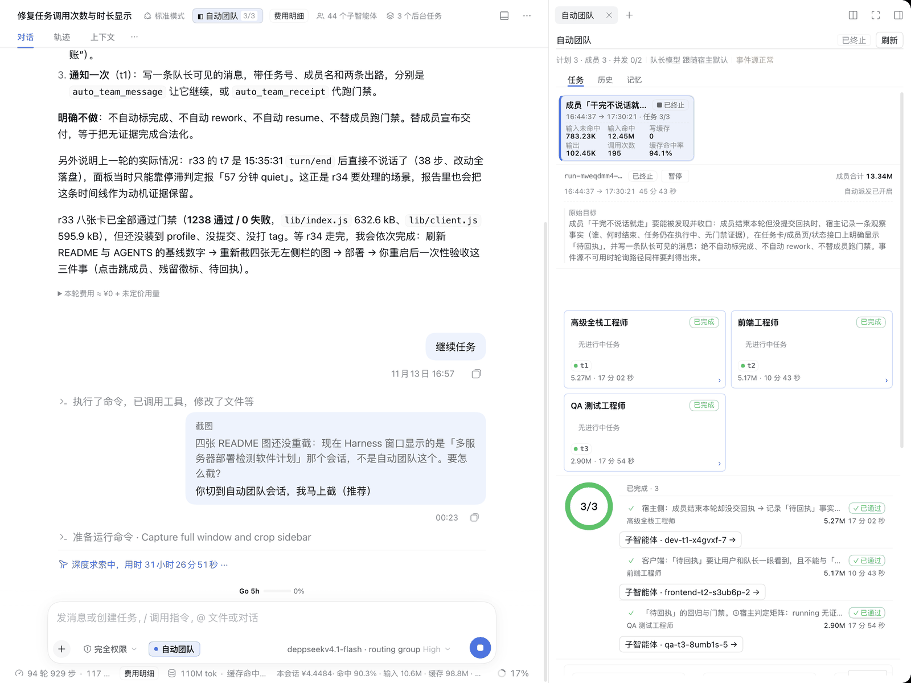
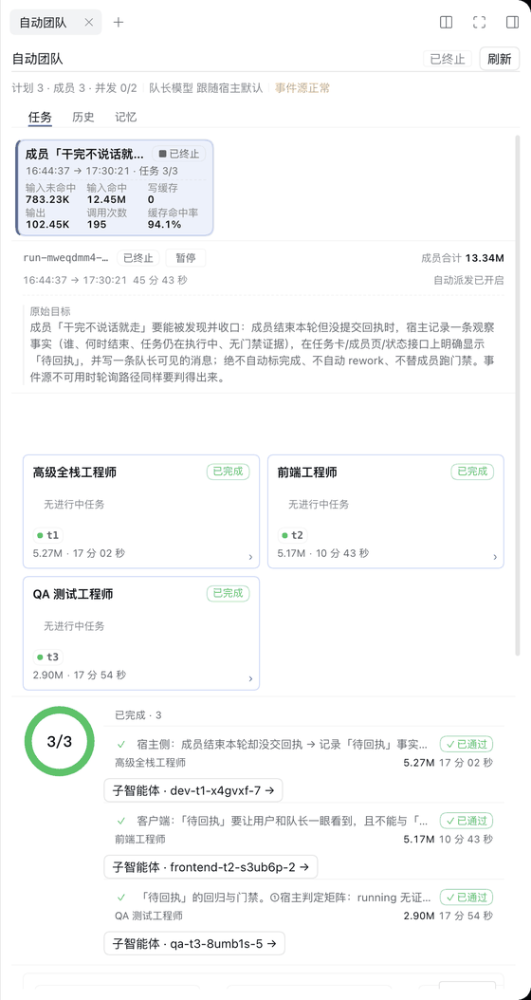
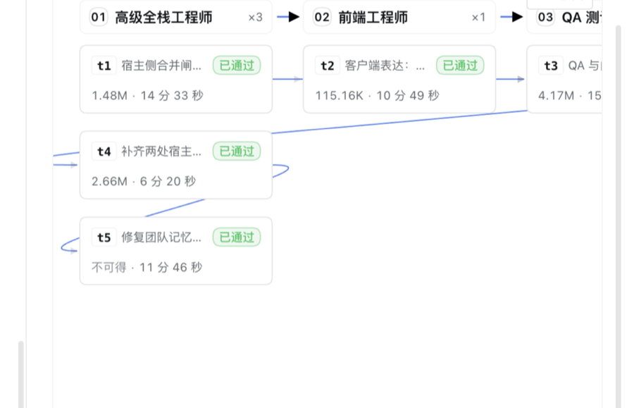

# dsh-auto-team（自动团队）

[简体中文](./README.md) · [English](./README.en.md)

把当前 DeepSeek Harness 会话变成队长：目标拆成**带依赖的任务图**，按角色**并行**派出可续聊的子 Agent，完成必须过**质量门禁**，全过程在输入框左侧开关与右栏面板里可见可改。

当前版本 `dsh-auto-team@0.2.13`（`package.json`），兼容 Node `>=22.18` 与 DSH `>=0.2.1-alpha.2 <0.3.0`，本机真机验证宿主 `0.2.2-rc.2`。

## 特色

1. **多任务 + 依赖图**：一个目标拆成带 `dependsOn` 的任务图，`maxConcurrent`（默认 3，可配 1..8，并被宿主上限夹紧）决定同时在跑几条；上游必须过门禁转 `done`，下游才从 `blocked` 解锁；流程图节点可点进执行它的成员会话（`src/client/views/FlowCanvas.tsx` 的 `onJump` → `uiWorkspace.openSession`，没成员或会话不可达时把原因说出来，不静默）。
2. **自动组队**：队长读目标后按任务性质挑 `roleId`（内置 11 个角色：产品 / 架构 / 全栈 / 前端 / 后端 / 设计 / QA / 文档 / 评审 / DevOps / 安全审计），角色不存在就不猜、报 `ROLE_UNAVAILABLE` 且不派发；写域 `writeScopes` 互斥，冲突任务进 `waiting` 并写清「在等谁、等哪条路径」，**不占并发位**；角色卡显示「角色 / 任务 / 用时」。
3. **子 Agent 独立模型**：角色可绑定 `model{provider,model,reasoningEffort}`，未声明就跟随会话默认；解析不到就拒绝派发（`MODEL_UNRESOLVABLE`），不静默回退队长模型；复用 idle 成员前要比对「角色目标路由」与「该成员真实会话路由」，不一致改为新建并留一条消息（`src/host/team/dispatch.ts` 的复用闸门）。
4. **门禁 = 证据**：任务从 `running` 到 `done` 的唯一入口是 `auto_team_receipt`——真跑 acceptance，记退出码与**输出尾部 4000 字符**（全量在 `<工作区>/.auto-team/artifacts/<taskId>.log`）；失败转 `rework` 并把证据回发原成员，下游保持 `blocked`。
5. **面板可观测**：run / 任务 / 成员三级都有用时与 token（输入命中、输出、调用次数、缓存命中率 = `cacheRead / (input + cacheRead)`），来源没上报就写「不可得」，不补 0、不估算；停滞分三态 `none` / `quiet` / `unreported`，只有 `quiet`（有推进信号但久未推进）才标黄，`unreported` 报「证据不足」；成员结束本轮却没交回执记 `silentFinish`，任务行显示「待回执」并只通知队长一次。
6. **团队记忆 + 成员自助**：记忆是双轨 md（公共 + 项目），条目分 P0/P1/P2、`supersede` 取代旧条目、按字符预算注入（默认 4000，超出不进上下文，只留 `mem://` ID 可 expand）；成员可在自己的子会话查自己那条任务、交自己那份回执，传别人的 `taskId` 回 `FORBIDDEN`。

## 30 秒上手

以下命令都在仓库根执行，先复制这一行（在任意子目录都会落到仓库根）：

```bash
export REPO="$(git rev-parse --show-toplevel)" && cd "$REPO"
```

1. **安装**（本机 profile 是 `desktop`，`dsh` 不在 PATH）：

```bash
cd "$REPO" && pnpm install
cd "$REPO" && pnpm build
cd ~/.dsh/profiles/desktop
pnpm add "file:$REPO"
grep -n '"dsh-auto-team"' package.json
```

`grep` 只有 1 行（缺 `dsh.profile.bundles`）时，手工在数组里补 `"dsh-auto-team"` 再重启。

2. **打开开关**：重启宿主、刷新 GUI。输入框**左侧**的「自动团队」胶囊是按会话的总开关，默认关；判定生效要四者都在——胶囊、会话头按钮、右栏页签、设置页分区，只缺一个就是没装好。

3. **派第一个任务并验收**：对队长说目标（如「把这个需求拆成任务派给团队」），队长 `auto_team_plan` 落计划——每条任务必须带 `roleId` 与**可执行的** `acceptance`（空验收整批拒绝），落盘即**自动派发**；成员回报后由开着开关的队长会话（或该任务成员自己）交回执，`auto_team_receipt` 真跑验收，`exit 0` 才 done。

回滚同样是三条命令（期望最后一行输出 `0`）：

```bash
cd ~/.dsh/profiles/desktop
pnpm remove dsh-auto-team
grep -c '"dsh-auto-team"' package.json
```

## 一条需求怎么跑完

| 步骤 | 发生什么 | 你能看到 / 能改的 |
| --- | --- | --- |
| 拆解 | 队长 `auto_team_plan` 拆成带 `dependsOn` 的任务，每条带 `roleId` + `acceptance`；空验收、依赖不存在或成环整批拒绝 | 面板「计划」页可改角色、取消任务；取消后成员数为 0 |
| 派发 | 按依赖取就绪任务，最多 `maxConcurrent` 条；写域冲突进 `waiting` 排队；`auto_team_dispatch` 只做幂等确认（缺 `runId` 直接拒绝） | 任务行状态：`pending` / `waiting` / `running` / `gate` / `rework` / `done`；暂停、中断、失败、取消、跳过分别是 `paused` / `interrupted` / `failed` / `cancelled` / `skipped` |
| 干活 | 成员是可续聊子 Agent，队长用 `auto_team_message` 直达；idle 成员可复用，路由不一致就新建 | 成员卡、流程图节点点一下直达该成员会话 |
| 交回执 | 成员或队长 `auto_team_receipt` → 真跑 acceptance，记退出码与输出尾部；失败转 `rework`、证据回发同一成员、下游保持 `blocked`，单任务返工上限默认 3（可配 1..10） | 门禁结论与命令、全量日志在 artifacts；「返工」徽标 + 失败证据，超限不再自动重试 |
| 需求变了 | `revise: true` 并回同一个 run（不传就新建）；`auto_team_add_tasks` 追加，作废任务在下游保持 `blocked` | 面板顶部「需求更新」胶囊 |

## 能力一览

| 能力 | 入口 | 说明 |
| --- | --- | --- |
| 启用 / 停用（按会话，默认关） | 输入框左侧胶囊 | `conversation.input.left`；关掉时所有工具回「未启用」 |
| 右栏面板（任务 / 历史 / 记忆） | 右栏「自动团队」页签 | keyed slot：`sidebar.right.pane.tab` + `.title`，还必须注册进 `sidebarRightTabs` |
| 项目库 / 记忆 | 左栏「自动团队」栏目 + 主区整页；面板「记忆」页（项目轨）、左栏「全局」（公共轨） | 主区注册失败自动降级为面板内联库；双轨 md，也可用 `auto_team_memory` |
| 参数 / 角色 / 技能 | 设置页「自动团队」 | 6 个参数；内置 11 个角色 + 12 个技能，可改不可删（技能可恢复出厂） |
| 队长工具（8 个） | 开关打开的会话内直接调用 | `plan` → `dispatch` 是骨架；`add_tasks` / `status` / `message` / `receipt`（唯一完成入口）/ `memory` / `role` 配套；未启用时全部回同一句「自动团队未启用…」 |

## 界面

四张真机截图（macOS 桌面端，1728×1084；任务页与依赖图来自 2026-11-10 实跑的 5 任务 / 5 成员 run）：


面板总览：会话主区 + 右栏「自动团队」，左侧导航已裁掉。


任务页：运行头（`计划 5 · 成员 5 · 并发 0/3`）、用量块、按角色归并的成员卡（角色 / 任务 / 用时）、完成环与逐任务验收结论。


依赖图：每个节点标 token 与用时（取不到就写「不可得」，不写 0），点节点直达执行它的成员会话。


入口：输入框左下角的胶囊开关，按会话启用；关掉时不创建任何成员。

四张图的原文件：[面板总览](docs/images/panel-overview.png)、[任务页](docs/images/panel-tasks.png)、[依赖图](docs/images/panel-flow.png)、[入口](docs/images/entry.png)。

## 兼容性与版本支持

| 组件 | 要求 / 实测 | 依据 |
| --- | --- | --- |
| Node.js | `>=22.18`（声明）；本机实测 `v26.11.1` | `package.json` 的 `engines.node`；`node -v` |
| DSH 宿主 | `>=0.2.1-alpha.2 <0.3.0`（声明）；真机验证 `0.2.2-rc.2`（macOS 桌面端） | `package.json` 的 `engines.dsh`；`CFBundleShortVersionString` |
| 成员 API 分界 | **0.2.2-rc.2 起**成员能力在 `subagents`；旧 `agentTeams` 只剩任务簿方法 | `src/host/adapters.ts` 的 `HostSubagents` |

**诚实边界**：本机只装 `0.2.2-rc.2`，`0.2.1-alpha.2 ~ 0.2.2-rc.1` 的旧路径只有单测桩覆盖、没有真机回归；`engines.dsh` 是声明范围，不是每版都验过。

```bash
node -v
node -e "const p=require('./package.json');console.log(p.version,p.engines.node,p.engines.dsh)"
```

许可证：MIT（见 [LICENSE](LICENSE)）

## 数据落点

| 路径 | 内容 |
| --- | --- |
| `~/.dsh/auto-team/runs/` | 运行状态：计划、任务、成员绑定、门禁证据、`termination` |
| `~/.dsh/auto-team/sessions.json`、`settings.json` | 各会话的开关；6 个可配参数（并发、记忆预算、停滞阈值、返工上限、门禁超时、队长模型） |
| `~/.dsh/auto-team/roles/<id>.json`、`skills/<id>.md` | 角色与技能（内置首次启动 seed，可改不可删） |
| `~/.dsh/auto-team/memory/public/`、`<workspace>/.auto-team/memory/` | 公共记忆（跨项目）与项目记忆；项目 `workspace` 按 run 的真实项目解析，解析不到时返回 `degraded/degradeReason` |
| `<会话工作区>/.auto-team/artifacts/<taskId>.log` | 门禁全量日志（验收里的相对路径可直接用） |

面板接口 `GET/POST /api/auto-team/*` 现在先过宿主自己的准入：Host/Origin 不可信返回 `403`、无认证 Peer 返回 `401`，未通过不进任何业务逻辑。旧宿主没有 `connection.requestRejection` 时退化为旧行为（不拦请求），宿主日志只告警一次——这与宿主自身 `/api/*` 的口径对齐，不是在插件里另加一层鉴权。

落盘核对与历史数据整理（回填幂等，整理先 dry-run）：

```bash
ls ~/.dsh/auto-team/
ls ~/.dsh/auto-team/runs/ | tail -5
ls .auto-team/memory/
node src/host/memory/backfill-cli.ts --dry-run
node src/host/memory/curate-cli.ts --track project --dir "$(pwd)/.auto-team/memory" --dry-run
```

## 故障排查

只列最常见的三条，其余见 [ARCHITECTURE.md](docs/teamflow/architecture/ARCHITECTURE.md) §9 与 [memory.md](docs/teamflow/memory.md)。

| 症状 | 真实原因 | 处置 |
| --- | --- | --- |
| 所有工具都回「未启用」 | 工具按 `exec.agent.id` 认会话，面板按真实 session 记开关 | 在**同一会话**点开关；不要用 `'current'` 兜底 |
| 构建全绿、右栏页签永不出现 | keyed slot 缺 `key`，或没把页签注册进 `sidebarRightTabs` | 两处 key 与 `register({id})` 必须同值；改完跑 `pnpm test` |
| 面板接口一律 `HTTP 404` | `webServer` 在 `apply` 时还没激活 | 本仓已两级注册（先试一次 + `ctx.inject(['webServer'])`）；Network 里 `GET /api/auto-team/snapshot?sessionId=…` 应 200 且带 `roles` |

```bash
grep -rn 'sidebarRightTabs' src/client/slots.ts
grep -rn 'ctx.get' src/host/adapters.ts | wc -l
node --test test/r29-packaging.test.ts
```

## 已知限制

- **成员会话只能看 / 交自己的任务**，且成员自助也受开关约束：run 所属队长会话关掉时，`status` 与 `receipt` 同回「未启用」。
- **并发可能被宿主夹小**：设置填 6 实际只并行 3；设置是请求上限，快照带 requested / clamped 标记。
- **左栏栏目与主区整页项目库未真机验证（U2）**：注册失败会自动降级为面板内联库，右栏不受影响；界面四图里也只覆盖右栏与输入框入口。
- **暂停只掐派发、回执与停滞判定**：已在跑的成员会继续写文件，要立刻停只能在面板中断该成员；计划落盘即自动派发，没有「先审后发」开关，想先复核就先点「暂停」。
- **老 run 的用量可能永远「不可得」**：结束于旧构建、会话已销毁；记忆页的 token 带 `≈`，是按字符估算（约「字符数 / 2」），不是 provider 上报值。

## 开发与验证（提交前必须全绿）

```bash
cd "$REPO" && pnpm typecheck
cd "$REPO" && pnpm test
cd "$REPO" && pnpm build
node --input-type=module -e "await import('./lib/index.js')"
node --input-type=module -e "await import('./lib/client.js')"
npm pack --dry-run --cache /tmp/npm-pack-cache
```

一行复现整链：

```bash
export REPO="$(git rev-parse --show-toplevel)" && cd "$REPO" && pnpm typecheck && pnpm test && pnpm build && node --input-type=module -e "await import('./lib/index.js')" && node --input-type=module -e "await import('./lib/client.js')" && npm pack --dry-run --cache /tmp/npm-pack-cache
```

- 基线（2026-11-17 实测）：`pnpm test` **1430 通过 / 0 失败 / 0 skipped**；`npm pack --dry-run` 9 个文件（`package.json`、`LICENSE`、中英两份 README、`cordis.patch.yml`、两份 `lib/`、`locale/en.json`、`locale/zh.json`），`LICENSE` 由 npm 自动收录。
- 不要绕过：`lib/` 必须入库（`pnpm add file:` 的安装源）；本地 import 带 `.ts` 扩展名；host 与 client 零直接 import，只走 `GET/POST /api/auto-team`；宿主服务读取集中在 `src/host/adapters.ts`。

## 文档索引

| 想看什么 | 去哪 |
| --- | --- |
| 架构、模块契约、数据流转、构建 / 测试 / CI、未完成清单 | [ARCHITECTURE.md](docs/teamflow/architecture/ARCHITECTURE.md) |
| 宿主事件、UI 槽位、真机验证 | [HOST-EVENTS.md](docs/teamflow/architecture/HOST-EVENTS.md)、[UI-SLOTS.md](docs/teamflow/architecture/UI-SLOTS.md)、[REAL-HOST-VERIFY.md](docs/teamflow/architecture/REAL-HOST-VERIFY.md) |
| 同一需求修订的合并 / 作废 / 停止态 | [r21 合并与重规划](docs/teamflow/2026-11-10-r21-merge-replan/QA-REPORT.md) |
| 团队约定与踩坑 | [memory.md](docs/teamflow/memory.md) |
| 每个需求的任务夹（按日期倒序即迭代史） | [docs/teamflow/](docs/teamflow/) |
| 协作守则与文档索引 | [AGENTS.md](AGENTS.md) |
