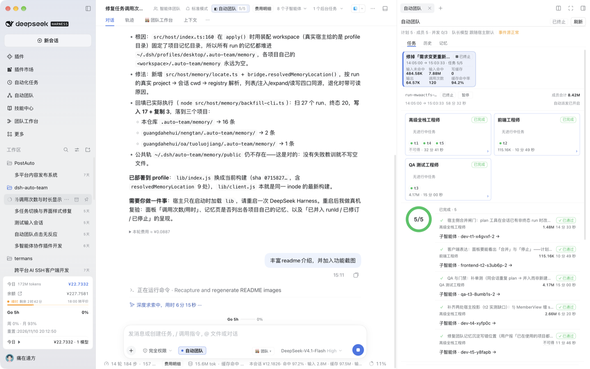
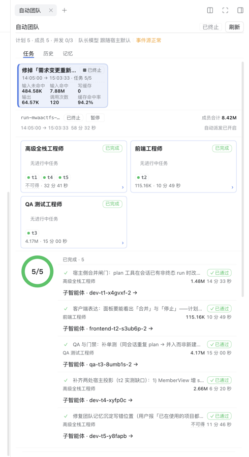
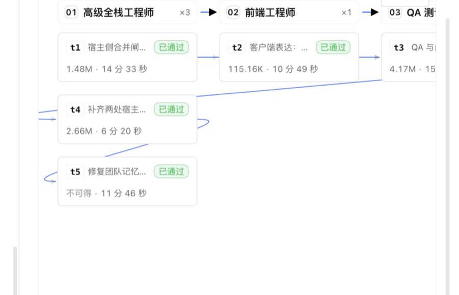

# dsh-auto-team（自动团队）

[简体中文](./README.md) · [English](./README.en.md)

把当前 DeepSeek Harness 会话变成队长：目标拆成**有依赖的任务图**，按角色**并行**派出可续聊成员，完成必须过**质量门禁**，全过程在输入框左侧开关与右栏「自动团队」面板里可见可改；需求改了就**并回同一个 run**，而不是再开一份互相打架的计划。



- 包名 / 版本：`dsh-auto-team@0.2.1`（`package.json`）
- 运行时约束：Node `>=22.18`；DSH `>=0.2.1-alpha.2 <0.3.0`（`package.json` 的 `engines`）
- 本文件所有命令默认在仓库内执行，先复制这一行（在仓库任意子目录都成立，执行后 `$REPO` 就是仓库根）：

```bash
export REPO="$(git rev-parse --show-toplevel)" && cd "$REPO"
```

## 兼容性与版本支持

| 组件 | 要求 / 实测 | 依据 |
| --- | --- | --- |
| Node.js | `>=22.18`（声明）；本机实测 `v26.11.1` | `package.json` 的 `engines.node`；`node -v` |
| DSH 宿主 | `>=0.2.1-alpha.2 <0.3.0`（声明） | `package.json` 的 `engines.dsh` |
| 真机验证版本 | DSH `0.2.2-rc.2`（macOS 桌面端） | `CFBundleShortVersionString` + `app.asar` 内的版本串 |
| Team API 分界 | **0.2.2-rc.2 起**成员能力在 `subagents` 服务；旧 `agentTeams` 只剩任务簿方法 | `src/host/adapters.ts:59-101`（`HostSubagents`）、`:62-65`（宿主注释原文） |
| 双路径兼容 | 逐个 `typeof` 探测：新接口优先，旧接口按能力回退 | `src/host/adapters.ts:1304-1310`、`:1392-1413`、`:1428-1450`、`:1543-1556`、`:1862-1871` |

### 宿主 API 分界：0.2.2-rc.2 把 Team API 迁到 `subagents`

宿主注释原文：*teammates are subagents, so subagent limits and inbox delivery apply*。因此 `agentTeams` 上的成员方法（`spawnTeammate / sendMessage / listMembers / tryMembership / interrupt`）**已被移除**，只剩任务簿方法（`isEnabled / setEnabled / createTask / getTask / listTasks / updateTask`）；成员能力整体搬到 `subagents`。

| 能力 | 0.2.2-rc.2 起（新宿主） | 旧宿主回退 | 本仓代码 |
| --- | --- | --- | --- |
| 创建成员 | `subagents.startActivation({ provider, label, name, prompt, parent, signal, delivery: 'parent', agentOptions })` | `agentTeams.spawnTeammate(caller, request)` | `src/host/adapters.ts:1333-1359` / 旧分支 `:1364` |
| 直达消息 | `subagents.sendMessage(caller, targetSessionId, content, { signal })`（按 **SessionId** 直发） | `agentTeams.sendMessage(caller, { target: 成员名, content, signal })` | `src/host/adapters.ts:1392-1413` |
| 中断成员 | `subagents.resolveName(caller, name)` → `subagents.interrupt(sessionId, authority)` | `agentTeams.interrupt(caller, name)` | `src/host/adapters.ts:1428-1450` |
| 成员名单 | `subagents.listDescendants(rootOf(caller).id)` | `agentTeams.listMembers(caller)` | `src/host/adapters.ts:1543-1556` |
| 成员身份 | `subagents.namesOf(agent)`（从 root 起的斜杠路径，root 是 `lead`） | `agentTeams.tryMembership(agent)` | `src/host/adapters.ts:1862` / `:1871` |

两个已在真机踩过的命名陷阱：

- **创建成员请求里的 `provider` 是 subagent provider 名，不是 LLM provider 名**：宿主拿它查 `subagents.getProvider(name)`，本机注册表只有 `spawn`；填 `opencode-go` 这类 LLM provider 会得到 `no subagent provider registered for "<name>"`，**每次派发都失败**（r12 真机事故）。本仓兜底顺序：`getProvider('spawn')` → `list()` 注册表（优先 `spawn`）→ 常量 `spawn`（`src/host/adapters.ts:1010`、`:1269-1287`）。
- **逐角色模型不走 `provider` 字段**，而是 `agentOptions: { provider, model, reasoningEffort, maxTokens }`，由 `startActivation` 带下去（`src/host/adapters.ts:1119-1131`）。

诚实边界：本机只装了 0.2.2-rc.2，`0.2.1-alpha.2 ~ 0.2.2-rc.1` 的 `agentTeams` 旧路径**无法在本环境回归**；它目前只有单测桩覆盖（`test/adapters.test.ts` 的新旧宿主用例），没有真机证据。`engines.dsh` 是声明支持范围，不是「每个版本都验过」。升级到 0.2.2-rc.2 后按「安装生效的判定」逐条确认即可。

## 它解决什么问题

- **一个人干不完一条需求**：队长把目标拆成任务图，按角色（产品 / 设计 / 架构 / 全栈 / QA + 自建）派给子 Agent，依赖没做完的任务不会抢跑。
- **并行不打架**：写域（`writeScopes`）互斥，同一时刻只有一份任务改动同一片文件；并发上限默认 3、可配 1..8，并被宿主上限夹紧。
- **「做完了」不算数**：每条任务都带可执行验收命令，`exit 0` 才转 done；失败自动返工，证据回发原成员，下游保持 blocked。
- **需求改了不用重来**：同一个 run 里修订任务、追加任务、作废旧任务，已跑的成果保留，面板上看得见「已修订 / 已作废 / 已停止」。
- **钱和时间有账**：每个任务、每个角色、每次 run 的 token 与用时都是真实数字；取不到就显示「不可得」，**不补 0、不估算**。

## 功能截图

以下截图取自真机（macOS DSH 桌面端，1728×1084 窗口，2026-11-10 实跑的一次 5 任务 / 5 成员 run）。

### 任务页：进度、角色、依赖图一屏看完



运行头是 `计划 5 · 成员 5 · 并发 0/3 · 队长模型 跟随宿主默认 · 事件源正常 · 已终止`；下面依次是本次 run 的用量块（`调用次数 120`、缓存命中率 94.2%）、按角色归并的成员卡（各带真实调用次数与累计用时）、完成环（5/5）与每个任务的验收结论。顶部带「需求更新」标记的胶囊说明这次 run 被修订过。

### 依赖流程图：谁在等谁、每个任务花了多少



实线 = 已完成，虚线 = 未完成；任务卡上直接带 token 与用时（如 `1.48M · 14 分 33 秒`）。图中 `t5` 的 token 是 `不可得` —— 那次没有可读的用量来源，面板如实留白，而不是写 0。

### 开关与入口


输入框左下角的「自动团队」胶囊是**按会话**的总开关（关闭时所有工具回「未启用」，不会偷偷起人；**成员自助也受开关约束**：成员视角查询与回执提交同样以 run 所属队长会话的开关为前置）；左栏「自动团队」是跨 run 的项目库入口。

## 30 秒看懂

1. 输入框**左侧**点开「自动团队」胶囊开关。默认关；开关按会话记在 `~/.dsh/auto-team/sessions.json`，只改开关不会起人。
2. 把目标直接说给队长。队长先调 `auto_team_plan` 落一份任务图，每条任务必须带 `roleId` 与**可执行的** `acceptance`（空验收整批拒绝、一条不落盘）。
3. 计划落盘后**自动派发**，不需要你点「派发」：并发上限、依赖门禁、写域冲突、暂停四道闸都在同一处（`src/host/team/dispatch.ts` 的 `dispatchReady`）判定，超出并发的任务排队。
4. 成员交付并向队长回报后，由**开着开关的队长会话或该任务的成员自己**提交回执 → `auto_team_receipt` 执行该任务的 `acceptance`，**exit 0 才算 done**；失败转返工（rework），下游保持 blocked，失败证据回发原成员。成员子会话可用 `auto_team_status` 自查自己那条任务（字段白名单，看不到成员/记忆/角色/其它任务），并用 `auto_team_receipt` 提交**自己任务**的回执（传别人的 taskId 返回 `FORBIDDEN`；其它工具仍回「未启用」）。**成员自助也受开关约束**：run 所属队长会话的开关关闭时，这两个工具对成员同样回「未启用」原文案（不会一个放行、一个拒绝）。
5. 需求要改：对队长说清楚改什么，队长用 `revise: true` **并回同一个 run**（见「同一需求的修订」）；不相关的新需求照旧新建 run。

## 能力与入口

| 能力 | 入口 | 现状 |
| --- | --- | --- |
| 启用 / 停用（按会话，默认关） | 输入框左侧胶囊 `conversation.input.left` | 挂载点见 `src/client/slots.ts:41` |
| 打开右栏面板 | 会话头按钮 `conversation.session.header.actions` | `src/client/slots.ts:44` |
| 面板三页：任务 / 历史 / 记忆 | 右栏「自动团队」页签（keyed，`sidebar.right.pane.tab` + `.title`） | `src/client/Panel.tsx:81`（`TABS` 单源；`TabKey` 类型在 :78） |
| 项目库（跨 run 列表、历史详情、全局记忆） | 左栏「自动团队」栏目 `sidebar.panellist` + 主区整页 `main` | `src/client/slots.ts:441,449`；主区注册失败会降级为面板内联库 |
| 参数与角色/技能管理 | 设置页「自动团队」`settings.section` | 6 个参数 + 角色/技能编辑（`src/client/SettingsPage.tsx`） |
| 记忆 | 面板「记忆」页只列**项目记忆**；公共记忆在左栏「全局」 | 双轨 md，读写也可用 `auto_team_memory` |
| 角色 | 内置 **11** 个 + 自建；每角色可指定 `provider/model` | `src/host/roles/builtin.ts:230`（`BUILTIN_ROLES`） |
| 技能 | 内置 **12** 个；来源 `builtin/imported/system/manual`，内置可改、可恢复出厂 | `src/host/roles/builtin.ts:22`（`BUILTIN_SKILLS`） |
| 用量 / 用时 | 任务卡「调用次数」等六项、run 头用时、角色卡累计用时 | 取不到即「不可得」，见「用量与用时」 |

> 面板里**没有**「派发」按钮：派发由计划落盘自动触发，人能做的是暂停/继续、改角色、取消/跳过单任务、改验收命令。角色页已从面板移除，只在设置页维护。

## 同一需求的修订（revise）

**只有同一需求的修改才并回旧 run**；不相关的新需求照旧新开 run。判定权在队长：`auto_team_plan` 不传 `revise` 就**永远新建**，不存在「自动猜着并入」。

| 参数 | 作用 |
| --- | --- |
| `revise: true` | 唯一的并入开关；目标 run 取 `runId`，缺省为当前会话最近的非终态 run |
| `runId` | 并入哪个 run；指向终态 run 直接 `BAD_REQUEST`，不会静默新建 |
| `changeSummary` | 变更要点，原样写进给在跑成员的直达消息与任务卡的修订说明 |
| `cancelledTaskIds` + `cancelReason` | 被新需求作废的任务：转 `cancelled`，面板显示作废原因 |

- `tasks[]` 里 **id 命中既有任务 = 更新**其目标/验收，**新 id = 追加**；同一批既更新又作废整批拒绝。
- `goal` 以 `## 需求修订（YYYY-MM-DD HH:mm）` 段落**追加**，原目标保留，历史可追溯。
- 返回三种 `mode`：`created`（新建，附带「如需修改请传 revise=true」的 `activeRunId` 提示）、`revised`（`updated[]/added[]/cancelled[]/skipped[]/notified[]/stopped[]` 全量回执）、`appended`（纯追加）。
- 成员不是静默消失：被作废者收到「已被新需求作废（原因：…），请立即停止当前实现，不要按旧理解提交回执」；被修订者收到「目标/验收已更新」；未受影响者也会被告知「整体需求已修订、你的目标与验收未变」。
- 停止是**先落盘再中断**：`stopping`（已发出中断，尚未确认停止）→ 中断成功才 `stopped` + `stoppedAt`；中断失败保持 `stopping` 并给出原因，**绝不假报已停止**。
- 最后一批任务全被作废时，run 自动收口为 `terminated` 并写 `finishedAt` + `termination.reason`，用时仍可算。

## 安装（本机 profile = `desktop`，`dsh` 不在 PATH）

前置：`node -v` ≥ 22.18；profile 目录 `~/.dsh/profiles/desktop` 已存在，且当前进程对该目录有写权限（`pnpm add` 要改 profile 的 `package.json`，受限沙箱会话会被拒绝）。

```bash
cd "$REPO" && pnpm install        # 首次 clone 必做：tsdown/typescript 在 devDependencies（本仓用 pnpm 10.x 验证）
cd "$REPO" && pnpm build          # 先产出 lib/index.js + lib/client.js（安装源就是 lib/）
cd ~/.dsh/profiles/desktop
pnpm add "file:$REPO"
grep -n '"dsh-auto-team"' package.json   # 应看到两行：依赖项一行、dsh.profile.bundles 一行
```

`grep` 只出现 1 行（只有依赖、没有 bundles）时，手动在 `dsh.profile.bundles` 数组里补 `"dsh-auto-team"`，再重启。

安装生效的判定（缺一即未生效）：

1. 重启 DeepSeek Harness 宿主进程，刷新 Web GUI。
2. 输入框左侧出现「自动团队」胶囊；会话头出现同名按钮；右栏出现「自动团队」页签；设置页出现「自动团队」分区。
3. 对队长说「用 `auto_team_status` 看一下当前团队状态」：返回快照结构（没有计划时字段为空）算激活；返回「自动团队未启用…」只说明**开关没开**，不是装坏了。

回滚：

```bash
cd ~/.dsh/profiles/desktop
pnpm remove dsh-auto-team
# 再从 package.json 的 dsh.profile.bundles 中删掉 "dsh-auto-team"
grep -c '"dsh-auto-team"' package.json    # 期望 0
```

## 队长可用的 8 个工具

未启用时全部返回同一句中文错误：`自动团队未启用：请在输入框内的「自动团队」选项处启用后再试。`

| 工具 | 用途 | 关键约束 |
| --- | --- | --- |
| `auto_team_plan` | 落一份执行计划，返回 `runId` | 空 `acceptance` / 非法写域整批拒绝，一条不落盘；带 `revise: true` 时改为并入既有 run（见上一节） |
| `auto_team_add_tasks` | 往**同一个** run 追加任务 | 必须带 `runId`；内容指纹幂等；整批原子；已终止的 run 拒绝 |
| `auto_team_dispatch` | 手动派发就绪任务 | **必须带 plan 返回的 `runId`**，缺了直接拒绝（保证计划早于成员） |
| `auto_team_status` | 读计划、成员、门禁证据、消息账本 | 只读；无计划时返回空字段而不是报错；成员会话只回自己那条任务（字段白名单），且要求 run 所属队长会话的开关开着 |
| `auto_team_message` | 直达成员（按 taskId 或成员名定位） | 可续聊；中断后用同一 `memberId` 继续，不要新建同名成员 |
| `auto_team_receipt` | 提交回执并跑门禁 | 任务 `running → done` 的**唯一**入口；成员口头说完成不算。**开着开关的队长会话或该任务的成员自己**可提交（成员自助也受开关约束：run 所属队长会话的开关关闭时与 status 同回「未启用」）；成员传别人的 `taskId` 返回 `FORBIDDEN`，门禁仍由宿主执行（`src/host/tools.ts` 的 `memberIdentityOf` 与 receipt 分支） |
| `auto_team_memory` | 读写双轨记忆（`list/read/write/expand/curate`） | `write` 支持 `importance`（P0/P1/P2）、`topic`、`supersedes`；按归一化正文判重并累计「修正次数」；`read/list` 返回条目结构化视图（id/level/text/source/revisions/superseded）；`expand` 按 `mem://` ID 取全文；`curate` 整理旧流水（`dryRun` 缺省 true）；返回里带 `projectDir/workspace/degraded/degradeReason` |
| `auto_team_role` | 角色读写（`list/save/remove`） | 内置角色可改不可删 |

## 门禁（acceptance）语义

- 执行目录 = **会话工作区**（`agent.session.header.cwd`）：每次跑门禁时按 sessionId 现取（装配层 `src/host/index.ts` 的 `sessionWorkspace()` → `src/host/adapters.ts` 的 `sessionWorkspaceOf()`），工具回执与面板动作都按各自会话解析。
  - 取不到时（旧宿主没有 `agents.get`、会话尚无 Agent、解析抛错）回退到装配 `workspace`（`options?.workspace ?? process.cwd()`），与修复前行为一致；回退路径不会被当成错误拒绝。
  - 门禁日志落在 `<会话工作区>/.auto-team/artifacts/<taskId>.log`，验收命令里的仓库相对路径（如 `test -s README.md`）可直接使用。
- 默认超时 `300000ms`（`GATE_TIMEOUT_MS`），证据保留输出**末 4000 字符**（`GATE_TAIL_CHARS`）。
- 判定：`exit 0` = 通过；非 0、超时、被信号杀（`exitCode: null`）都算失败。
- 失败 → 任务转 `rework` 并把命令/退出码/输出尾部回发给同一成员；其下游保持 `blocked`，不会带着坏上游往下跑。
- 写域：只有 `running` / `gate` 状态占用写域，离开即释放；冲突 = 相等或**目录边界前缀**（`src/host` 与 `src/hostile.ts` 不冲突）。等待者会收到一条释放通知，任务卡显示「等待写域」。
- 5 类不可逆动作需要二次确认（`cancel` / `cancelTask` / `skipTask` / `updateAcceptance` / `forceParallel`），其余动作可逆、不弹窗；确认后复用同一个执行体，行为不漂移。

## 用量与用时

面板上的数字只有三种来源，**取不到就写「不可得」并给原因**，任何一处都不补 0、不估算：

| 指标 | 来源 | 什么时候不可得 |
| --- | --- | --- |
| token（输入/输出/缓存读写/命中率） | 宿主 `sessionProjections` 的 tokenUsage 投影，按成员落盘 | 投影读不到（旧 run 未落盘、会话已销毁） |
| 调用次数 | 成员会话事件流里 `assistant/message` 的条数（一条 = 一次模型调用） | 会话事件不可读；可读但为 0 时是真实 0 |
| 用时 | run：`plannedAt → finishedAt`（进行中用当前时刻）；任务：`taskTimes[id]` 的起止；角色：名下任务用时**累计** | 缺开始/结束时刻（已开始却缺 `startedAt`、时间倒流） |

- 终态 run 的历史数据缺 `finishedAt`（旧版本落盘）时，按 `max(taskTimes[].endedAt)` 与最后一条消息时刻的较大值**派生**一次，只读不写盘，历史 run 的用时因此仍可算。
- 已开始但缺时刻会写成人话，例如「不可得：任务 t3 缺少开始/结束时刻」；从未开始的任务贡献 0，不算缺失。

## 记忆（双轨 md + 条目级）

团队记忆是 md 文件，分两轨：公共轨 `~/.dsh/auto-team/memory/public/`（跨项目）、项目轨 `<workspace>/.auto-team/memory/`。每个主题一个文件，条目一行一条：

```
# 失败与教训

- [P1] 门禁 `pnpm test` 失败（退出码 1）（来源：系统 · 11-10 17:20 · 修正 1）
```

- **主题文件**：`conventions`（约定兜底）、`pitfalls`（失败教训）、`decisions`（决策，project 轨专属）、`commands`（已验证命令）、`domain`（业务领域，project 轨专属）、`architecture`（架构）。公共轨另有 `workflow`、`host`；project 轨另有 `ui`。主题由正文关键词自动路由，`topic` 显式指定时只认本轨主题，越权直接 `BAD_TOPIC`（不静默降级）。
- **等级**：`P0` 铁律/人工置顶（自动沉淀**永不**产生 P0，淘汰永不选 P0）；`P1` 失败教训与旧手写行；`P2` 默认与已验证命令。同一条目再次写入时等级取高、`revisions` 加一。
- **上限**：文件数 project 8 / public 6（新增主题文件超限先报错，要求先整理）；每个文件 40 条活动条目，超限按「P2 最旧 → P1 最旧」淘汰，全 P0 时拒绝写入并给出可读原因。tombstone（`## 已作废` 段）不计入 40，但每文件最多保留 20 条。
- **自动沉淀**：run 进入 `terminated` / `cancelled` 后只写 `pitfalls/P1`（失败证据；无失败不写）与 `commands/P2`（`exit 0` 且带命令的门禁证据，按正文 hash 去重）；有失败时公共轨额外 1 条 `pitfalls/P1` 提醒。**不再生成** `run-<runId>.md` / `lessons-*.md`，旧流水文件仍可读但默认不解析、不计配额、**永不注入**。
- **注入**：按条目选择（P0 优先，再按目标相关性），排除已作废条目与旧 `run-*.md`，预算沿用 `MEMORY_INJECT_BUDGET`（默认 4000 字符，可在设置里调）；放不下的条目列成「另有 N 条未内联」尾行，用 `auto_team_memory expand` 按 `mem://` ID 取全文。
- **整理旧流水**：把旧 `run-*.md` 里的失败证据提炼进 `pitfalls.md`（只补不改、幂等）：

```bash
cd "$REPO" && node src/host/memory/curate-cli.ts --track project --dir "<项目记忆目录>" --dry-run   # 先预览
cd "$REPO" && node src/host/memory/curate-cli.ts --track project --dir "<项目记忆目录>"             # 再执行
```

面板「记忆」页也可用「整理旧流水」按钮先 dry-run 预览再执行；`auto_team_memory` 的 `curate` action 同样支持，且 `dryRun` 缺省为 true。

## 数据落点

| 路径 | 内容 |
| --- | --- |
| `~/.dsh/auto-team/runs/` | 运行状态（计划、任务、成员绑定、门禁证据、`termination`） |
| `~/.dsh/auto-team/sessions.json` | 各会话的开关 |
| `~/.dsh/auto-team/settings.json` | 6 个可配参数（并发 1..8 默认 3、记忆预算 200..4000、停滞 1s..600s 默认 90s、返工上限 1..10、门禁超时 1s..600s 默认 300s、队长模型） |
| `~/.dsh/auto-team/roles/<id>.json` | 角色定义（一角色一文件；内置首次启动 seed，可改不可删） |
| `~/.dsh/auto-team/skills/<id>.md` | 技能正文（内置覆盖层 + 导入/系统/手写，带 frontmatter） |
| `~/.dsh/auto-team/memory/public/` | 公共记忆（跨项目） |
| `<workspace>/.auto-team/memory/` | 项目记忆。`workspace` 按 **run 的真实项目**解析（`run.project` → 会话 cwd → workspace registry），不再用装配 workspace；全都解析不到时明确退化到装配目录，并在快照与 `auto_team_memory` 返回里带 `degraded/degradeReason` |
| `<会话工作区>/.auto-team/artifacts/<taskId>.log` | 门禁全量日志（跟随会话工作区；取不到时回退装配 workspace） |
| `~/.dsh/auto-team/deviations.jsonl` | 队长亲自写文件的留痕（append-only） |

历史遗留的项目记忆可用回填命令搬回各自项目（幂等，已存在的不覆盖）：

```bash
cd "$REPO" && node src/host/memory/backfill-cli.ts --dry-run   # 先看会搬什么
cd "$REPO" && node src/host/memory/backfill-cli.ts             # 实际执行（mode=apply）
```

路径派生集中在 `src/host/paths.ts` 与 `src/host/memory/locate.ts`：`globalDataRoot` 已含 `.dsh`，不要再拼一层（会落到 `~/.dsh/.dsh/…`，症状是「保存成功、重启全丢」）。唯一例外是会话开关 `sessions.json`，由 `src/host/bridge.ts:468` 用 `${deps.dataRoot}/sessions.json` 拼出。

## 开发与验证（提交前必须全绿）

```bash
cd "$REPO"
pnpm typecheck      # tsc --noEmit
pnpm test           # node --test test/*.test.ts
pnpm build          # 双产物：lib/index.js（ESM）+ lib/client.js（CJS 套 __ModuleLoader__ 壳）
node --input-type=module -e "await import('./lib/index.js')"
node --input-type=module -e "await import('./lib/client.js')"
npm pack --dry-run --cache /tmp/npm-pack-cache   # 必须含 lib/index.js、lib/client.js、cordis.patch.yml、中英两份 README 与 locale/*.json
```

### 实测基线（2026-11-13 06:25，工作区 HEAD `608cb24` + 未提交改动）

```bash
export REPO="$(git rev-parse --show-toplevel)" && cd "$REPO" \
  && pnpm typecheck && pnpm test && pnpm build \
  && node --input-type=module -e "await import('./lib/index.js')" \
  && node --input-type=module -e "await import('./lib/client.js')" \
  && npm pack --dry-run --cache /tmp/npm-pack-cache
```

- `pnpm typecheck` → exit 0
- `pnpm test` → **1179 通过 / 0 失败 / 0 skipped**，exit 0（约 7.4s；含 `test/r29-packaging.test.ts` 的 6 条打包/文档回归）
- `pnpm build` → exit 0，`lib/index.js` **613.65 kB**、`lib/client.js` **587.57 kB**
- 两条 `import` 自检 → exit 0
- `npm pack --dry-run` → **8 个文件 / 384.5 kB**（`package.json`、中英两份 README、`cordis.patch.yml`、两份 `lib/`、`locale/en.json`、`locale/zh.json`）

数字会随实现漂移：要拿当前数就重跑上面这组命令，不要拿本表去比对 CI 产物；包体积也随 README 自身大小变化（这次 pack 时 README 为 37.9 kB）。

不要绕过这几条：`lib/` 必须入库（`pnpm add file:` 的安装源）；本地 import 必须带 `.ts` 扩展名；host 与 client 零直接 import，只走 `GET/POST /api/auto-team`；**宿主服务读取集中在 `src/host/adapters.ts`**，装配入口 `src/host/index.ts` 只允许 `ctx.logger` 日志调用（:316 / :654 / :658）。

## 故障排查

| 症状 | 真实原因 | 处置 |
| --- | --- | --- |
| 构建全绿、右栏页签永不出现 | keyed slot 缺 `key`，或没把页签注册进 `sidebarRightTabs` | 两处 key 与 `sidebarRightTabs.register({id,kind})` 必须同值；改完跑 `pnpm test`（含 slot 约定用例） |
| 所有工具都回「未启用」 | 工具按 `exec.agent.id` 认会话，面板按真实 session 记开关 | 确认是在**同一会话**点的开关；不要用 `'current'` 兜底 |
| 面板接口一律 `HTTP 404` | `webServer` 在 `apply` 时刻还未激活 | 本仓已两级注册：先试一次，再 `ctx.inject(['webServer'], cb)`；自检看浏览器 Network 里 `GET /api/auto-team/snapshot?sessionId=…` 是否 200 且响应带 `roles` |
| 页签出现但内容空白、点了没反应 | 前端把 `{data,error}` 整包当数据用 | 读接口必须解构 `{data,error}`（历史高频 bug 族） |
| 装完 GUI 毫无变化 | 没重启宿主 / `cordis.patch.yml` 的 `name` 写成了子路径 | `name` 必须是包根名 `dsh-auto-team`，否则 clientModules 扫描会跳过 |
| 面板上某些数字是「不可得」 | 数据源真的没有（旧 run 未落盘、会话已销毁、缺起止时刻） | 这是刻意的诚实态；按「用量与用时」表核对来源，不要改成补 0 |
| `npm pack` 报 `EPERM …/_cacache/tmp/…` | 运行环境对 npm 默认缓存目录 `~/.npm` 不可写；**不是文件属主问题**：`find ~/.npm -user root` = 0，属主是当前登录用户（非 root），本会话对 `~/.npm/_cacache` 的 `touch` 同样是 `Operation not permitted`（沙箱拒绝写工作区外目录） | 加 `--cache /tmp/npm-pack-cache`（或用可写的 `HOME=/tmp/...`）。**不要** `sudo chown -R <uid>:<gid> ~/.npm`：uid:gid 换机即错，改家目录属主有破坏性，且解决不了沙箱写限制 |

## 已知限制 / 未完成

每条按「现象 → 原因 → 规避」写。

- **成员会话只能看到/提交自己的任务（且成员自助也受开关约束）**
  - 现象：成员会话里 `auto_team_status` 只回自己那条任务，`auto_team_receipt` 只受理自己的 `taskId`，其余工具一律回「未启用」；**run 所属队长会话的开关关闭时，这两个工具对成员也回同一句「未启用」**。
  - 原因：成员身份靠 `exec.agent.id` 反查 `bindings[].memberId`（`src/host/tools.ts` 的 `memberIdentityOf`），只对 status/receipt 开了成员分支；成员分支的准入还要再叠一层开关校验（`memberSelfServiceOf`：身份命中 + run 所属队长会话 `enabled`），所以开关关闭时两工具同态拒绝，不会一个放行一个被桥拦；没有绑定也不放行，也不暴露计划全量。
  - 规避：需要成员自查/交回执时让队长会话保持开着开关；需要看全量计划、成员名单或记忆时，回到开着开关的队长会话操作；需要委派/协调也由队长发起。
- **设置里的并发可能被宿主上限夹小**
  - 现象：设置填 6，实际只并行 3。
  - 原因：`src/host/index.ts:177-192` 的 `hostConcurrency()` 以宿主上限为天花板（设置是上限请求，不是替代宿主约束）。
  - 规避：按面板/快照显示的实际生效值预期（快照带 requested 与 clamped 标记）。
- **左栏主区整页项目库未在真机验证（U2）**
  - 现象：真机上左栏「自动团队」栏目或主区整页可能不出现。
  - 原因：这段注册整体包在 `try/catch` 里，且未在真机验证过视觉与交互。
  - 规避：注册失败会自动降级为面板内联项目库，弹窗与右栏不受影响。
- **暂停只掐派发、回执与停滞判定**
  - 现象：点了「暂停」，已在跑的成员仍会继续写文件。
  - 原因：暂停不打断已启动的成员轮次，也不清门禁证据。
  - 规避：要立刻停手只能在面板中断该成员；暂停用于「别再派新的」。
- **计划落盘即自动派发，没有「先审后发」开关**
  - 现象：`auto_team_plan` 一返回，成员就可能已经被创建。
  - 原因：派发由计划落盘自动触发（没有独立的派发开关）。
  - 规避：想先复核就先点面板「暂停」，确认计划后再继续。
- **老数据可能永远不可得**
  - 现象：升级后看历史 run，某些任务的 token / 调用次数仍显示「不可得」。
  - 原因：这些 run 结束于旧构建，从未落盘用量；成员会话也已销毁，事件流读不回来。
  - 规避：新的 run 会正常落盘；历史数据只能保持诚实留白，不要为「好看」补 0。
- **记忆页的 token 带 `≈`**
  - 现象：记忆页的 token 是估算值。
  - 原因：按字符数估算（`src/host/format.ts` 的 `memoryTokenEstimate`，约「字符数/2」），不是 provider 上报值。
  - 规避：`≈` 只用于横向比较记忆条目大小；真实的调用用量看任务/运行维度。
- **本机 `npm pack` 的默认缓存不可写**（见故障表）
  - 现象：不加 `--cache` 时 `npm pack` 报 `EPERM …/_cacache/tmp/…`。
  - 原因：运行环境对 `~/.npm` 不可写（不是属主问题）。
  - 规避：`--cache /tmp/npm-pack-cache` 绕行；**CI 不受影响**——`.github/workflows/ci.yml` 跑在 `ubuntu-latest`，`npm pack --dry-run` 是最后一步（:34），全新 runner 的 `~/.npm` 可写。

## 文档

- 架构与模块契约：`docs/teamflow/architecture/ARCHITECTURE.md`
- 宿主事件 / UI 槽位 / 真机验证：`docs/teamflow/architecture/HOST-EVENTS.md`、`UI-SLOTS.md`、`REAL-HOST-VERIFY.md`
- 产品记忆（约定与踩坑）：`docs/teamflow/memory.md`
- 需求任务夹（按日期倒序即迭代史）：`docs/teamflow/<yyyyMMdd-rN-slug>/`
  - 用量与调用次数：`docs/teamflow/2026-11-05-token-usage.md`
  - 修订合并与停止态：`docs/teamflow/2026-11-10-r21-merge-replan/`
  - 项目记忆落点：`docs/teamflow/2026-11-10-r22-memory-preflight/`
- 团队协作守则与文档索引：`AGENTS.md`

## 变更记录

### 2026-11-13 — 成员自助：自查自己的任务、自己提交回执（v0.2.1）

- 改了什么：`auto_team_status` / `auto_team_receipt` 在成员子会话里不再一律回「未启用」。宿主用 `exec.agent.id` 反查 `run.bindings` 中 `memberId` 相同且未退休的绑定（多个命中取 `plannedAt` 最大），命中即视为该成员：`status` 只返回 `{view:member, runId, task:{id,title,status,acceptance,dependsOn,evidence}, notice}`，不返回 members / 记忆 / 角色 / 其它任务 / plan 全量；`receipt` 只放行绑定里那个 taskId，传别人的任务回 `FORBIDDEN` 且不跑门禁、不写账本。门禁仍由宿主执行同一条路径（`bridge.act` + `preflightGate`），未新增旁路。
- 开关语义（补漏）：成员自助**也受**「自动团队」总闸约束——开关关闭时 status 与 receipt 同回「自动团队未启用…」，不会出现「能查状态、交不了回执」；开启时两者都放行。
- 为什么：此前成员拿不到自己的门禁结果，「完成必须过门禁」只能由队长代跑；成员写错一步也无法自查，等于把链断在成员侧。
- 怎么验：`pnpm test` 1179 通过（含 `test/r30-member-self-service.test.ts` 12 条：身份解析、字段白名单、他人任务 → FORBIDDEN、门禁失败 → 返工并回发证据、开关关闭时两工具同态拒绝、端到端提交 → done），突变反证 M1–M7；`test/r29-packaging.test.ts` 继续守住打包与文档对等。

### 2026-11-13 — 打包清单回归测试 + 实测基线刷新

- 改了什么：新增 `test/r29-packaging.test.ts`（6 条）——`version` 合法 semver；`engines.node` / `engines.dsh` 与中英 README「兼容性与版本支持」表逐字一致；`exports` 含 `./locale/*.json`、`files` 含 `lib` / `cordis.patch.yml` / `locale/*.json`；两份 locale 的 `meta.title` / `meta.description` 非空；两份 README 的 h2 数量与图片引用集合相等；真实 `npm pack --dry-run --json` 清单含 `lib/index.js`、`lib/client.js`、`cordis.patch.yml`、`README.md`、`README.en.md`、`locale/en.json`、`locale/zh.json`，且不含 `src/`、`test/`。本节「实测基线」同步刷新为 1167 例 / 8 个 pack 文件。
- 为什么：`exports` / `files` 与 README 支持矩阵靠人手同步，漂移时「构建全绿、单测全绿」，谁也发现不了；此前也没有任何断言检查真实发布清单——`npm pack` 少收 `locale/*.json` 只会在安装后表现为面板标题空白。
- 怎么验：`pnpm test`（1167 通过，含新增 6 条）。反向探针（改回错误实现必须变红）：把 `version` 改成 `0.1`、`engines.node` 改成 `>=22.20`、删掉 `exports` / `files` 的 locale 项、把 `locale/en.json` 的 `meta.title` 置空、把 README 里的图片引用改名，`node --test test/r29-packaging.test.ts` → 6/6 红；恢复后 6/6 绿。

### 2026-11-13 — README 双语化 + 兼容性矩阵

- 改了什么：顶部加语言切换行；新增「兼容性与版本支持」节（Node/DSH 的 `engines` 声明、真机验证的宿主版本、0.2.2-rc.2 的 Team API 分界、双路径回退对照表、两个命名陷阱）；新增 `README.en.md` 作为完整英译，结构、命令与图片引用与中文版一一对应。
- 为什么：此前只有中文 README，而「0.2.2-rc.2 起成员能力从 `agentTeams` 搬到 `subagents`」只写在代码注释里，换宿主版本安装时没有任何成文的支持边界。
- 怎么验：`test -s README.en.md && echo README_EN_OK`；图片引用两版一致（`grep -h -o 'docs/images/[a-z-]*\.png' README.md README.en.md | sort | uniq -c`，每张都是 2 次）；引用的行号用 `grep -n 'DEFAULT_SUBAGENT_PROVIDER = ' src/host/adapters.ts` 与 `grep -n 'canStartActivation\|canSpawnTeammate' src/host/adapters.ts` 复核。

### 2026-11-10 — 用量/用时给真数、同一需求修订并回旧 run、项目记忆按项目落盘

- **调用次数与用时不再恒定「不可得」**
  - `auto_team_plan` 落盘的用量里补上 `calls`：由成员会话事件流中 `assistant/message` 的条数得到（`src/host/adapters.ts` 的 `readSessionCallCount`），读不到就保留已落盘值，不写假数。
  - run 用时：`finishedAt` 在取消/全部任务收口时补写；历史 run 缺 `finishedAt` 时按任务结束时刻派生（`src/host/store.ts` 的 `finishedAtOf`，只读不落盘）。
  - 角色用时改为**名下任务累计**（进行中的任务按当前时刻计入）；未开始任务贡献 0，已开始却缺时刻才「不可得：任务 tX 缺少开始/结束时刻」。共享格式化下沉到 `src/shared/duration.ts`，宿主与客户端同一套口径。
- **同一需求的修订并回旧 run（`revise`）**：见「同一需求的修订」一节；成员状态扩到 11 态，新增 `stopping/stopped/cancelled/waiting`，停止先落盘再中断，失败保持「停止中」。
- **项目记忆落点修复**：此前 `apply()` 用装配 workspace 固定了项目记忆目录，真机上所有 run 的记忆都堆在 profile 目录里。现按 run 的真实项目解析（`src/host/memory/locate.ts`），列表/注入/expand/读写四口同源，并向快照暴露 `projectDir/workspace/degraded/degradeReason`；配套 `backfill-cli.ts` 把历史记忆幂等搬回各自项目。
- **怎么验**：`pnpm typecheck && pnpm test && pnpm build`（1023 例全绿）+ 两条 import 自检 + `npm pack --dry-run`；真机上核对 `/api/auto-team/snapshot` 的 `runDuration/taskDurations/taskUsage.calls` 与历史 run 的派生用时。截图见 `docs/images/`，取自同一次真机 run。

### 2026-11-05 — 门禁执行目录改为会话工作区

- 改了什么：`BridgeDeps.gate` 新增可选 `workspaceOf(sessionId)`；装配层用 `ctx.agents.get(sessionId)` → `agent.session.header.cwd` 解析会话工作区（`src/host/adapters.ts` 的 `sessionWorkspaceOf()` 是宿主形状的唯一翻译点）。`receipt` 与 `done` 任务改验收后的重跑都按会话目录执行，产物日志同根；取不到时回退装配 `workspace`（旧行为）。
- 为什么：修复前 `apply()` 只拿得到宿主进程 cwd（`~/.dsh/profiles/desktop`），验收命令里的仓库相对路径必然假红。
- 怎么验：`pnpm typecheck`（exit 0）+ `node --test test/gate-cwd.test.ts`（4 例：会话目录/回退/done 重跑/形状解析，全部通过）。

### 2026-11-04 — README 对齐 r13 实际契约

- 改了什么：按源码重写能力/入口表、安装与回滚、8 工具表、门禁与状态语义、数据落点、验证命令与实测基线、故障排查与已知限制。
- 为什么：旧版停留在 r1 口径（「内置 6 个角色」、输入框下方 dock 开关、面板含角色页、`pnpm test` 无基线），与 r10~r13 的实现不一致；文档与实现对不上比没有文档更有害。
- 怎么验：`pnpm typecheck && pnpm test` + 两条 import 自检 + `npm pack --dry-run`（可复现数字与基线 commit 见「开发与验证」的实测基线节，不在此重复）；每条数字的来源命令都记在 `docs/teamflow/20261103-r13-readme-refresh/FACTS.md`。
- 追加修正（同轮）：门禁执行目录原写成「会话 workspace」，实测是宿主进程 cwd（`~/.dsh/profiles/desktop`），导致相对路径验收假红；已按 `src/host/index.ts:102` 的真实取值改写「门禁」节、数据落点与已知限制。怎么验：在 `~/.dsh/profiles/desktop` 下把仓库根写成绝对路径跑同一套断言 → exit 0（同一断言用相对路径会 exit 1）。
- 追加修正（去作者路径）：开头准备行与实测基线复现命令里的 `$REPO` 不再写死本机绝对路径，统一改为 `export REPO="$(git rev-parse --show-toplevel)" && cd "$REPO"`，在仓库任意子目录粘贴都落到仓库根；基线那段合并成一条完整命令链。怎么验：`grep -cE '/Users/[A-Za-z0-9._-]+/' README.md` 期望输出 `0`（无命中时 grep 退出码为 1，看计数即可）；两段命令块原样粘贴到仓库子目录执行，第一段后 `pwd` 为仓库根，第二段整链 exit 0。

### 2026-11-04 — 按 t2 评审（B1–B5）与 t1 QA（D1–D7）修补

- 改了什么：
  - B1/B2：实测基线改为**锚定 commit**，补一行可复制的复现命令（`git rev-parse` 推导 `$REPO` 版）；`npm pack` 注明旧包体积的来源。
  - B3：EPERM 归因改为「运行环境对默认缓存目录 `~/.npm` 不可写」，删掉「`~/.npm` 是 root 所有」与 `sudo chown -R 501:20 ~/.npm`。
  - B4：删掉「CI 首步会红」，改为「本机缓存不可写用 `--cache` 绕行，`ubuntu-latest` 全新 runner 不受影响」（`ci.yml:34` 是最后一步）。
  - B5：正文步骤 4、工具表 `auto_team_receipt` 行、已知限制各补一条「只有开着开关的队长会话能提交回执；成员子会话必回『未启用』」。
  - N1～N8：`Panel.tsx:81`；记忆页 token 标为 `≈` 估算、只对任务/运行维度说「宿主上报」；宿主服务读取收窄为「集中在 `adapters.ts`，`index.ts` 仅 `ctx.logger`」；`sessions.json` 归到 `bridge.ts:408-409`；并发被宿主 clamp 进已知限制；快速开始补 `pnpm install`（pnpm 10.x）；用例数只留在基线表，变更记录改为引用。
- 为什么：t2 评审结论是「不可合并」——旧数字会让人拿 `438.38 kB / 233.4 kB` 去比对当前产物并误判装错，`sudo chown` 是无效且危险的建议，「CI 首步会红」是假警报，而「成员自交回执必失败」会在第一次使用时就撞上。
- 怎么验：`cd "$REPO" && sed -n '/## 故障排查/,/## 已知限制/p' README.md | grep -c 'root 所有'`（期望 `0`，故障表不再有属主归因）；`sed -n '/## 已知限制/,/## 文档/p' README.md | grep -c 'CI 首步'`（期望 `0`）；`grep -n 'cd2bb61\|00d2b55\|auto_team_receipt' README.md`（均有命中）。正文里 `sudo chown` 只出现在故障表「**不要** `sudo chown` …」这一句纠错提示中；数字出处见 `docs/teamflow/20261103-r13-readme-refresh/FACTS.md` §1 / §1.1 / §9。
